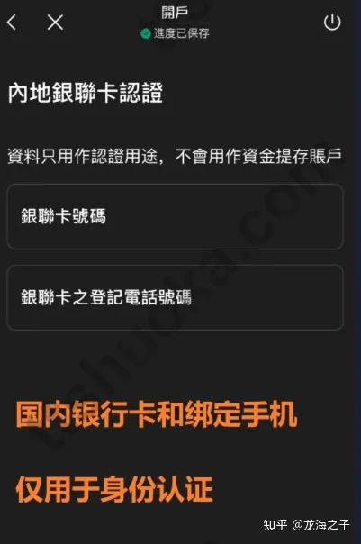
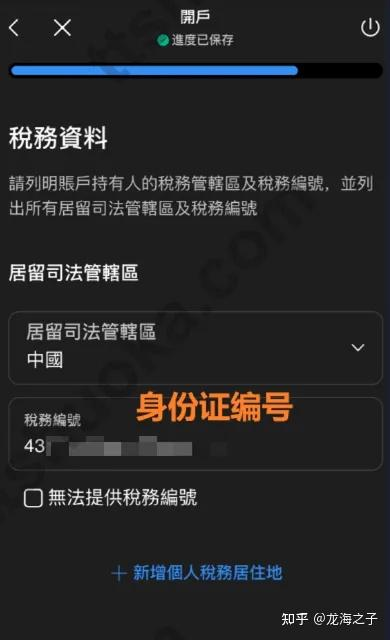

# 01 致富证券（Chief Group）港美股开户（美股免佣）

> 1979 年成立的港资老券商，**内地身份证 + 全线上 + 0 门槛**开户，目前是港股开户里对内地用户最友好的路径之一。

## ⚠️ 阅读前必读

- 🌐 **网络环境**：部分券商/银行的 App 与开户页面在**内地网络下无法完成提交**（提交转圈、验证码收不到、上传证件失败、"当前地区不支持"）。解法是**全局模式 + 境外节点**，但**居住地址与税务居民身份仍须如实填写**。详见 [13 网络环境](../13-network-environment.md)

1. **"0 门槛"指开户本身不设资产门槛**，不代表没有其他成本：入金通道、佣金最低收费、换汇点差、平台费照收。
2. **政策随时会变。** 2026 年 5 月实测时"无需海外地址证明"，但**这一状态不代表你现在仍然适用**。
3. 开户前请到 **SFC 公众登记册**核对牌照。

**查牌照**：<https://apps.sfc.hk/publicregWeb/> → 搜索 "Chief" → 确认持牌法团名称与开户合同上的主体一致。

---

<a id="promo-01-chief"></a>

> 💡 **用邀请码开户更快**：带上邀请码 `GU7865` 或直接走[开户邀请链接](https://www.chiefgroup.com.hk/hk/open?rl=ECR&PromoCode=GU7865) 进入，**开户审核更快、通过率更高，另外最高可以获得新人8888奖励**。

## 一、为什么是致富证券

| 优势 | 说明 |
| --- | --- |
| **牌照齐全** | 持有香港证监会第 1/2/4/5/6/7/9 类牌照（交易、期货、投行、资产管理等），1979 年成立 |
| **0 门槛** | 无最低资产要求，无初始入金门槛（首次入金按各渠道规则） |
| **全线上** | 注册 → 上传证件 → 实名认证 → 签名，全程线上完成，无需亲临香港 |
| **不卡海外地址** | 实测：无需提供境外居住地址证明；香港银行卡资料**可以后补** |
| **账户类型可选** | 保证金账户（含融资、打新等完整功能）或现金账户（仅现货） |

---

## 二、开户流程（五步）

### 第 1 步｜通过开户链接完成注册

- 官网入口：<https://www.chiefgroup.com.hk/hk/open>
- 推广链接参数为 `?rl=ECR&PromoCode=GU7865`
- 用**邮箱 + 手机号**注册，设密码

> 💡 建议直接走官网 `www.chiefgroup.com.hk` 手动进入开户页，避免第三方跳转页带入未知参数。

### 第 2 步｜上传身份证，选择保证金账户

- 上传**居民身份证正反面**（彩色、四角完整、无反光）
- **账户类型选择**：

| 类型 | 适合 | 注意 |
| --- | --- | --- |
| **保证金账户（Margin）** | 想做融资、港股打新、需要完整交易功能 | **建议直接选这个**，避免后期再升级麻烦 |
| 现金账户（Cash） | 只做最基础的现货交易 | 功能受限，后期升级需再走一次审核 |

> ⚠️ 融资账户的**实际可用杠杆倍数**仍受券商风控与你的资产情况约束，且会带来强制平仓风险，见 [09 风险与避坑](../09-risks.md#风险-2市场风险--高必然存在)。

### 第 3 步｜完成内地银行卡认证

- 填写：**内地银行卡号 + 该卡绑定的手机号**
- ⚠️ **这一步的银行卡用于身份认证，不是后续实际入金的卡**。填你本人的常用卡即可。



*致富证券：内地银行卡认证页*

### 第 4 步｜补充职业信息与税务资料

- 职业、收入来源、资产情况：**如实填写**
- **税务编号（TIN）**：内地居民用**身份证号**



*致富证券：职业信息与税务资料填写*

> 💡 税务居民身份填错会导致股息预扣率从 10% 变成 30%，详见 [04 美股开户 § W-8BEN](../04-us-account.md#2-w-8ben-怎么填逐项说明)。

### 第 5 步｜香港银行卡资料（**非前置项，可跳过**）

- **已有香港银行卡** → 直接填上
- **还没有** → **先跳过，之后再补**。实测这样更省时间，不要在这里卡住。

> 💡 需要香港卡是因为入金通道，见 [05 入金与出金](../05-funding.md)。

### 第 6 步｜风险披露与签名

- 按页面提示完成风险披露书、客户声明、签名页
- 提交后等待审核

---

## 三、开户后要做的

```
[ ] 收到开户确认信，登录账号
[ ] 绑定/补充香港银行账户（入金通道）
[ ] 完成首次入金
[ ] 设置交易密码 + 双重验证（2FA）
[ ] 核对佣金率与最低收费（见 07 费用拆解）
[ ] 开通新股认购权限（想打新的话）
[ ] 确认股息派发方式（现金 / 再投资）
```

---

## 四、常见问题

**Q：审核要多久？**
A：线上提交后通常 1–5 个工作日，具体以平台通知为准。补充香港银行卡资料通常不触发二次长审核。

**Q：为什么第 5 步可以跳过香港银行卡？**
A：开户审核与入金通道是**两件事**。券商为了确认客户身份需要 KYC，但具体资金从哪个账户进来可以后置。

**Q：没香港卡怎么入金？**
A：见 [05 入金路径图](../05-funding.md#52-入金路径图)——常规路径是"内地银行 → 香港同名账户 → 券商"，需要先开香港银行账户，见 [11 新规总表](11-rules-2026.md)。

**Q：这家能买美股吗？**
A：致富证券主营港股。**买美股个股**请看 [04 美股开户](../04-us-account.md)（盈透 IBKR 等）。

**Q：开户链接带 PromoCode，要不要用？**
A：推广码不改变你的费率结构与合规性。用不用都行，**建议先在官网核对完整费率表**。

---

## 五、风险与合规提示

| 项 | 说明 |
| --- | --- |
| ⚠️ **平台合规** | 港资券商向内地居民展业存在监管敏感度，政策可能随时调整，见 [09 风险 § 平台合规与清退](../09-risks.md#风险-1平台合规与清退风险--高) |
| 🚫 **别用别人的账户** | 账户不得转借，详见 [08 税务与合规](../08-tax-compliance.md) |
| ✅ **保留证据** | 开户全过程截图/邮件留档，将来对账、报税都用得上 |

---

**返回** → [攻略集索引](README.md) · 下一篇 → [02 盈立证券](02-broker-usmart.md)
