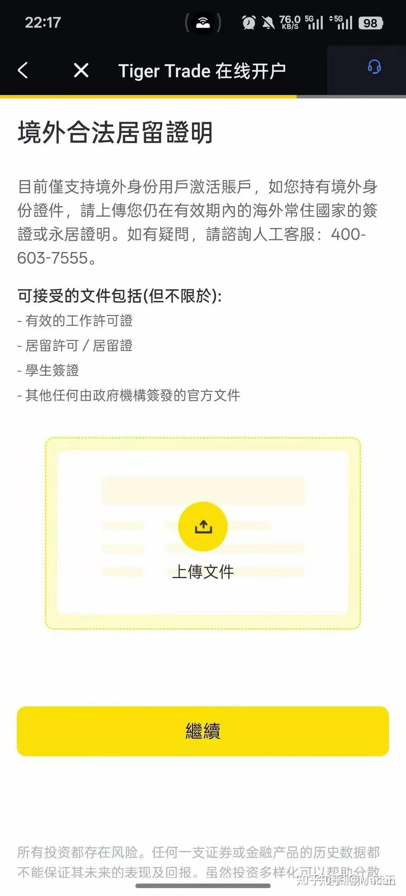
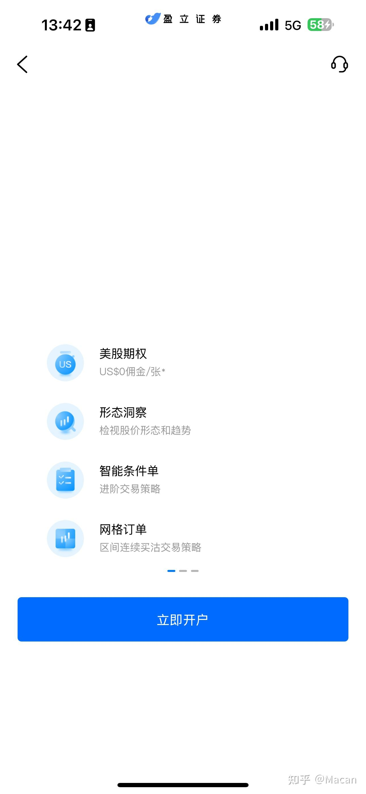
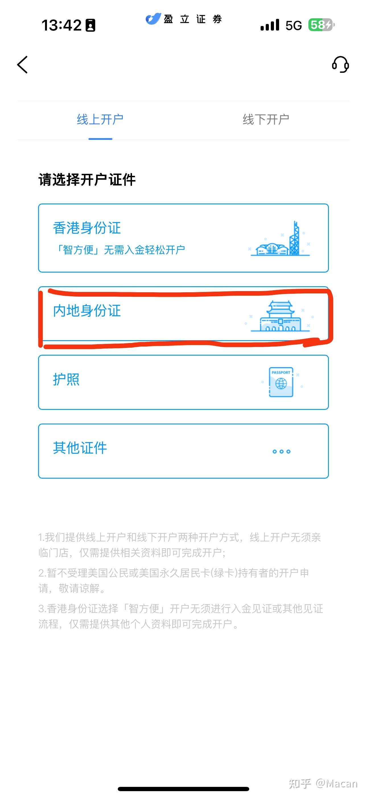
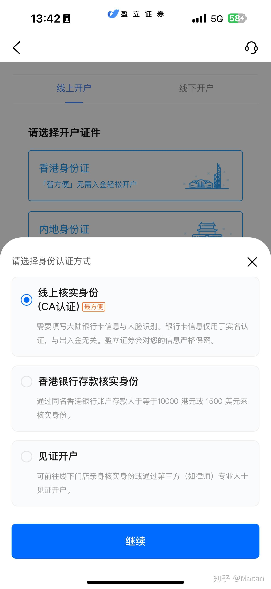
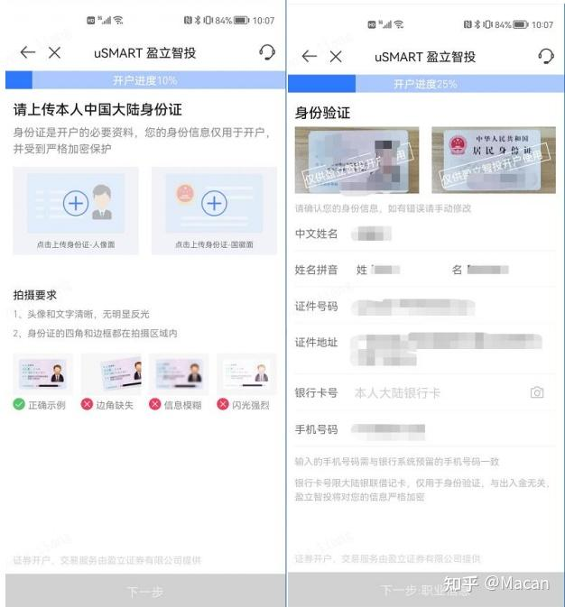
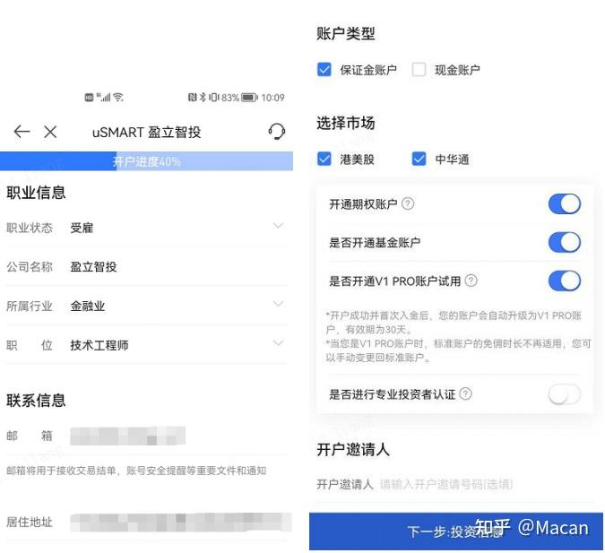
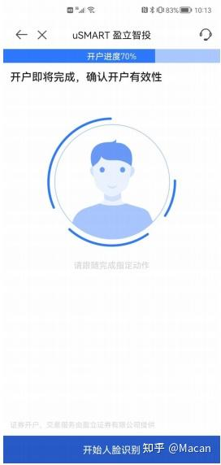
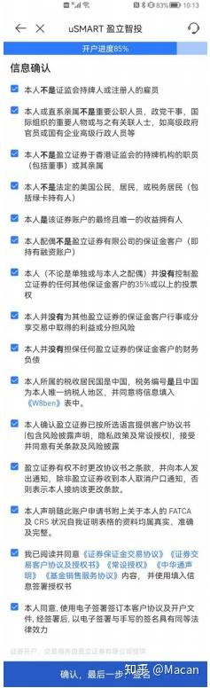
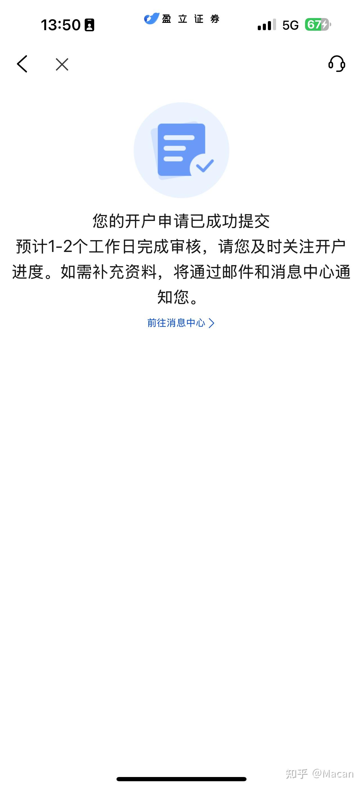

# 02 盈立证券（uSmart）港股开户

> 原文观点：国内外金融政策收紧后，老虎、富途、长桥等主流平台普遍要求海外居住/工作证明，**盈立是目前仍接受"内地身份证直接开户"的少数香港券商之一**。



*盈立：内地身份证开户入口（原文截图）*

---

## 原文信息

| 项 | 值 |
| --- | --- |
| 来源 | <https://zhuanlan.zhihu.com/p/1992233805193425359> |
| 原标题 | 2026 年 1 月盈立 HK 开户攻略及开户奖励 |
| 作者 | Macan |
| 原文更新 | 2026-02-05 |
| 本篇整理 | 2026-11-05（2026-11 更正主体名称，见下方"更正说明"） |
| 持牌法团 | **盈立證券有限公司 / uSmart Securities Limited** |
| SFC 中央編號 | **BJA907** |
| 官网 | <https://www.usmart.hk/> |

### ⚠️ 更正说明（本手册 v1.2 更正）

初版误将本文主体标注为「辉立证券（Phillip Securities）」。经查证：

- **盈立證券（uSmart Securities Limited，SFC CE BJA907）** ← 本篇讲的是这一家
- **輝立證券（Phillip Securities (Hong Kong) Limited，SFC CE AAG460）** ← **是另一家公司**，1971 年成立，与本篇无关

原文使用的注册域名 `m.usmart66.com` 与 App 名「香港盈立证券」均指向 **uSmart**。特此更正，避免读者去到错误的主体开户。

**查牌照**：<https://apps.sfc.hk/publicregWeb/> → 搜索 "uSmart" 或 "BJA907" → 确认持牌法团名称与开户合同一致。

---

## ⚠️ 阅读前必读

1. **"哪家还能开"是一个移动靶。** 原文写于 2026-01，列举的平台清单**很可能已经变化**。请自己再验证一遍，不要照抄名单。
2. **原文明确提到"政策收紧"**——这恰恰说明这类开户通道随时可能被关闭。开户前请直接问券商客服，并**要书面回复**。
3. **原文评论区有大量"被要求先转账核验身份"的反馈**，说明**审核规则不完全透明**，个体差异大。
4. 原文含推广注册链接与 ICode，是否使用请自行判断。

---

## 🎁 邀请码与开户链接

<a id="promo-02-usmart"></a>

> **本节为推广位。** 本仓库与下方机构存在推广合作，你使用邀请码/链接开户会给作者带来返佣。**返佣来自机构，不来自你，不影响你的费率与合规性**；作者不因返佣改变上文对流程与风险的判断。

| 项目 | 内容 |
| --- | --- |
| **邀请码** | `vv44x` |
| **开户邀请链接** | ⬜ 待补充 ⬅️ **请向作者索取**；
在链接补齐前，**直接填写邀请码 `vv44x`** 同样有效 |
| **推荐人** | 一只会说话的羊咩（跨境金融 KOL） |
| **官网** | <https://www.usmart.hk/> |

**为什么建议用邀请码 / 邀请链接开户？**

| 好处 | 说明 |
| --- | --- |
| **开户成功率更高** | 走推广通道进入的申请会带上**推荐人标识**。客服与合规侧能直接看到你的渠道归属，信息传递链路更顺，**被当成"来源不明的陌生申请"反复补件的概率更低** |
| **开户速度更快** | 推广通道的申请在人工复核队列里**渠道可识别**，资料齐全时通常 **1–3 个工作日**完成，而不是来回补件拖到一周以上 |
| **专属新人礼遇** | 部分机构对带邀请码的新客户有额外费率折扣、赠金或活动名额 |
| **问题可追溯** | 通过推荐关系开户，遇到卡审核时更容易找到对应的客服/合规接口推动 |

> ⚠️ **开户前先向客服确认三件事**（这一步能省掉后续扯皮）：
> 1. 使用邀请码 `vv44x` 后的**默认佣金率与最低收费**具体是多少？**有没有比不用邀请码更差？**
> 2. 邀请码对应的**优惠内容、门槛与有效期**分别是什么？
> 3. **不使用邀请码会不会被拒绝开户？**（正常情况下不会——邀请码只影响归属与优惠，不影响你的开户资格）
>
> 以上"成功率更高 / 速度更快"是**推广方口径**，请以上面三个问题的官方回复为准。

---

## 一、平台背景与定位

| 项 | 说明 |
| --- | --- |
| **法定名称** | 盈立證券有限公司 / uSmart Securities Limited |
| **SFC 中央編號** | **BJA907** |
| **牌照类型** | 第 1 类（证券交易）、第 2 类（期货合约交易）、第 4 类（就证券提供意见）、第 5 类（就期货合约提供意见）、第 6 类（就机构融资提供意见）、第 9 类（资产管理） |
| **定位** | 香港持牌**科技/智能型网上券商**，主打港股 + 美股 + ETF 的移动端交易体验 |
| **特色** | 在内地居民开户通道收紧的背景下，成为少数仍开放"内地身份证开户"的选项 |

---

## 二、开户流程（App 内五步）

### ① 通过链接注册，设好密码

- 官网：<https://www.usmart.hk/>
- 原文使用的注册链接为 `m.usmart66.com` 下的注册页，带 `ICode=261937`
- **推荐改用作者提供的邀请码 `vv44x`**，见上方 [🎁 邀请码与开户链接](#promo-02-usmart)

> 💡 **建议**：先到官网 `www.usmart.hk` 确认官方 App 的下载入口与开户路径，再决定是否使用推广链接。

### ② 下载官方 App「香港盈立证券」，用注册号码登录

- 选择：**「开户」→「内地身份证开户」**
- ⚠️ **这一步选错**（选成其他开户类型）会导致后面要求你补海外资料，原文评论区已有多人踩坑
- **注意 App 来源**：只从官网或官方应用商店下载，不要装第三方改版包



*盈立：App 内「开户」入口*



*盈立：选择「内地身份证开户」*



*盈立：开户方式选择*

### ③ 上传身份信息与受雇信息

- 按提示上传身份证、港澳通行证等
- **受雇信息如实填写**



*盈立：上传身份信息*



*盈立：受雇信息填写*

> 💡 原文评论区多人提到被要求"先转账核验身份"。**转账前务必确认收款方是券商官方公示的账户**，见 [09 诈骗识别清单](../09-risks.md#2-诈骗识别清单)。

### ④ 实名认证（人脸识别）

- 按提示完成活体/人脸核验
- 环境光线充足、不遮挡面部



*盈立：实名认证（人脸识别）*

### ⑤ 签名完成开户

- 提交后等待审核结果通知



*盈立：签名提交*



*盈立：开户完成*

---

## 三、开户奖励（2026 年新用户）

> ⚠️ 原文给出的是 **2026 年 1 月**的活动方案，**大概率已过期**。这里保留其结构，供你对照官网当前活动：

| 类型 | 原文描述 |
| --- | --- |
| 开户奖励 | 完成开户后按活动要求发放 |
| 入金奖励 | 原文注明"入金奖励另说"（需按活动页面条件） |

**活动类内容的通用提醒**：
- 活动常有**时间窗、金额门槛、交易笔数限制、需在规定期限内完成**等条件
- 部分券商的"佣金折扣"是**限时绑定**，到期后费率回升——**务必确认到期后的默认费率**
- 拿到奖励前不要为了凑门槛做无意义的交易，最低收费会吃掉优惠（见 [07.3 最低收费陷阱](../07-fees.md#73-最低收费陷阱)）

---

## 四、开户后

```
[ ] 确认账户类型（现金 / 保证金）与可交易品种
[ ] 绑定香港银行账户作为入金通道
[ ] 首次入金并确认到账
[ ] 核对佣金率、最低收费、平台费、提现费（完整费率表）
[ ] 确认股息派发与税费代扣方式
[ ] 设置 2FA
```

---

## 五、常见问题

**Q：盈立和富途/老虎比，有什么不同？**
A：盈立是港资**科技型网上券商**，在两地监管收紧的背景下仍保留内地身份证开户通道；富途/老虎/长桥平台体验更现代，但在多篇实测反馈中已被要求海外居住/工作证明。**但这随时会变，别把任何一家的现状当结论。**

**Q：邀请码会影响我的费率吗？**
A：**取决于机构的具体设计。** 正因为如此，开户前务必按 [上方"开户前先向客服确认三件事"](#promo-02-usmart) 问清楚默认佣金率与最低收费，拿到书面回复再开。

**Q：为什么评论里有人说被要求"先转账"？**
A：券商可能要求小额入金作为**身份与地址核验**的一部分。**前提是收款方必须是官方公示账户**；任何个人账户都是 🚫。

**Q：开户奖励值得为它多交易吗？**
A：通常不值得。把活动门槛与最低收费一起算，多数情况下正常交易更划算。

**Q：这类券商清退内地客户怎么办？**
A：见 [09 风险 § 平台合规与清退](../09-risks.md#风险-1平台合规与清退风险--高)。**只放一部分资金在境外平台**是最有效的对冲。

---

## 六、风险与合规提示

| 项 | 说明 |
| --- | --- |
| ⚠️ **准入政策不稳定** | 这正是本篇存在的意义，也正是它的风险所在 |
| ⚠️ **保留全部证据** | 活动条款、开户确认信、费率表截图 |
| ✅ **资金只走本人账户** | 本人银行 → 本人券商账户，见 [05 入金](../05-funding.md) |

---

**返回** → [攻略集索引](README.md) · 上一篇 → [01 致富证券](01-broker-chief.md) · 下一篇 → [03 汇丰香港](03-bank-hsbc.md)
