# 03 汇丰香港 HSBC ONE 线上开户

> 2025 年起汇丰 ONE **已关闭线下开户通道，线上申请成为内地居民的唯一入口**。资料齐全的话，30 分钟内可完成提交。

## 机构信息

| 项 | 值 |
| --- | --- |
| 官网 | <https://www.hsbc.com.hk/> |

## ⚠️ 阅读前必读

- 🌐 **网络环境**：部分券商/银行的 App 与开户页面在**内地网络下无法完成提交**（提交转圈、验证码收不到、上传证件失败、"当前地区不支持"）。解法是**全局模式 + 境外节点**，但**居住地址与税务居民身份仍须如实填写**。详见 [13 网络环境](../13-network-environment.md)

1. **必须本人在香港境内**，且通常要求连接**香港本地 Wi-Fi**。内地 IP + 漫游流量大概率被拒。
2. 网传的**"收入申报建议填 18,000–30,000 港币"** 属于**风控取巧建议**——**本手册不推荐照做**。收入申报应与你的实际情况相符；不实申报在反洗钱审查中属于风险点，也可能影响后续大额操作。
3. 汇丰的产品线（ONE / 卓越理财 / 运筹理财）门槛与权益会调整，请以官网为准。

---

## 一、核心变化：线下开户通道已关闭

| 变化 | 影响 |
| --- | --- |
| 汇丰 ONE **关闭线下开户** | 内地居民只能走 App 线上申请 |
| 申请时间约 30 分钟 | 资料齐全可一次提交成功 |
| 仍需**地址证明** | 与 2025 年新规一致，见 [11 新规总表](11-rules-2026.md) |

---

## 二、开户前准备

### 必备证件

| 材料 | 要求 |
| --- | --- |
| 港澳通行证 | 有效期 > 6 个月（建议留缓冲期），签注有效 |
| 内地身份证 | 有效期内 |

### 手机与网络

| 项 | 要求 |
| --- | --- |
| **NFC 功能** | 读取港澳通行证芯片（iPhone 7+ 或主流安卓，需提前开启 NFC 开关） |
| **国际漫游** | 接收短信验证码，提前联系运营商开通 |
| **香港本地 Wi-Fi** | 优先酒店、商场等稳定网络，**避免公共 Wi-Fi** |
| **定位权限** | 必须允许 GPS，用于确认身处香港 |

### 关键文件：出入境记录 PDF

1. 抵达香港后，在**微信或支付宝**搜索「**移民局 12367**」小程序
2. 路径：中国公民服务 → 出入境记录查询 → 下载 **带红章的 PDF**
3. ⚠️ **截图无效**，必须是 PDF
4. ⚠️ **需在入境当天操作**，确保记录时间与申请日期一致

📸 操作截图：出入境记录 PDF 的获取（3 张）

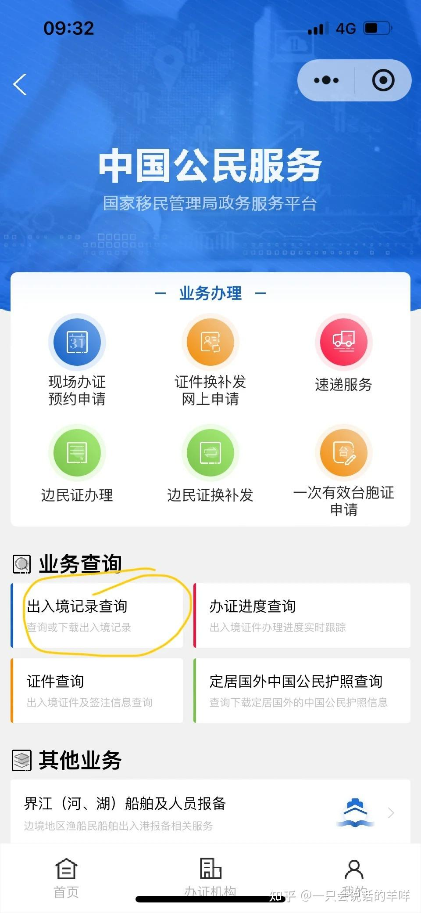

*汇丰：移民局 12367 查询出入境记录*

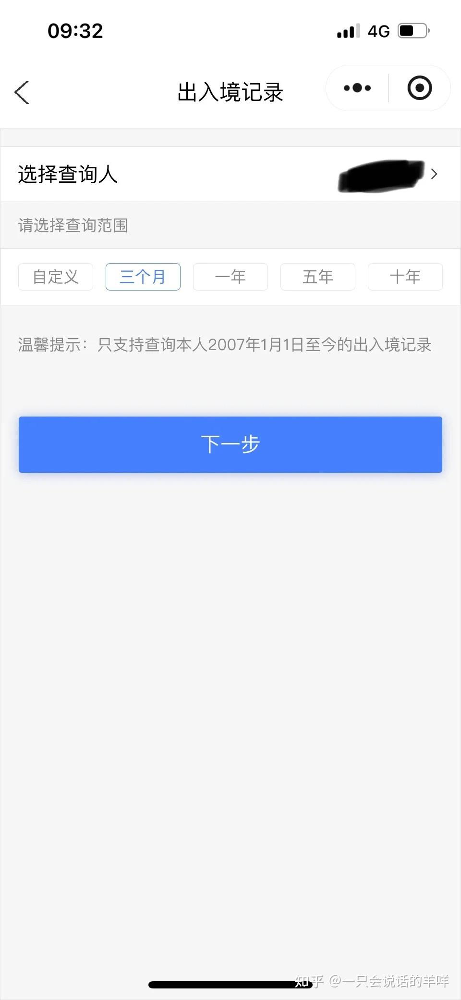

*汇丰：下载带红章的 PDF*

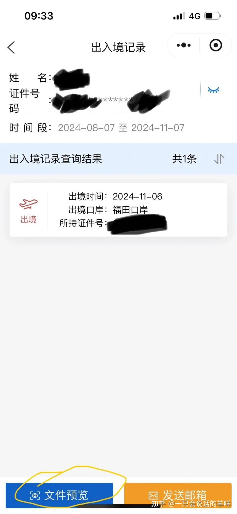

*汇丰：出入境记录 PDF 示例*

### 其他

- 常用**英文邮箱**（接收账户通知）
- **英文住址**：提前把居住地址写成拼音英文，例如 `Room 101, 88 Heping Road, Shenzhen`

---

## 三、线上开户流程

### ✅ 第一步：下载 App 与初始设置

- App Store / 官网下载官方 App「**HSBC HK**」
  - ⚠️ **安卓需从汇丰官网下载 APK**，应用商店版本可能不是最新版
- 打开后选「**我没有任何账户**」
- 国家/地区选「**中国**」
- 确认身处香港（需开启 GPS 定位）

### ✅ 第二步：账户类型与信息填写

| 项 | 建议 | 说明 |
| --- | --- | --- |
| **账户类型** | 普通用户选「**汇丰 ONE**」（0 门槛、无管理费）；高净值选「卓越理财」（需维持 100 万港币） | 卓越理财是**持续门槛**，不是一次性的 |
| **开户原因** | 勾选「**储蓄/投资**」或「日常理财」 | 注意：避免选「薪资」「学费支付」，可能触发额外审核 |
| **税务身份** | 中国居民务必选「**非香港税务居民**」 | 选错会影响港股股息预扣，见 [08 税务](../08-tax-compliance.md#3-香港税务要点) |
| **收入申报** | **按实际情况填写** | ⚠️ 不建议照抄"填中间值"的做法 |

📸 操作截图：开户申请全流程（11 张）

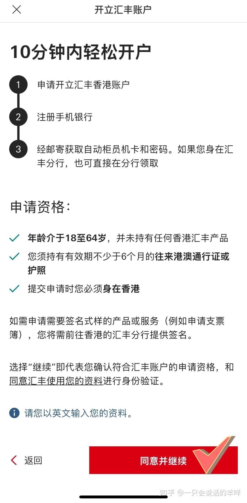

*汇丰开户 4/11*

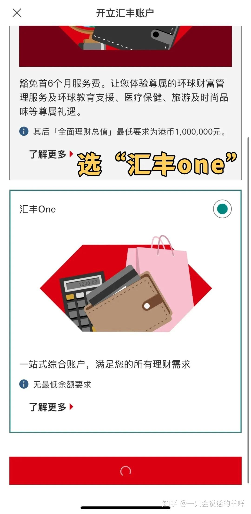

*汇丰开户 5/11*

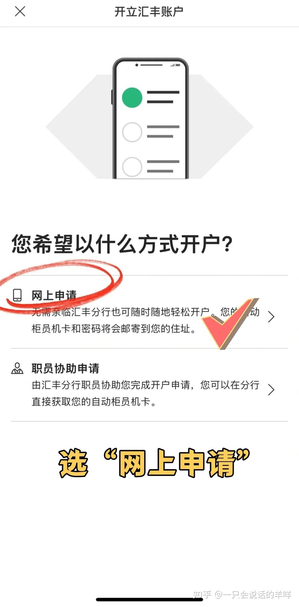

*汇丰开户 6/11*

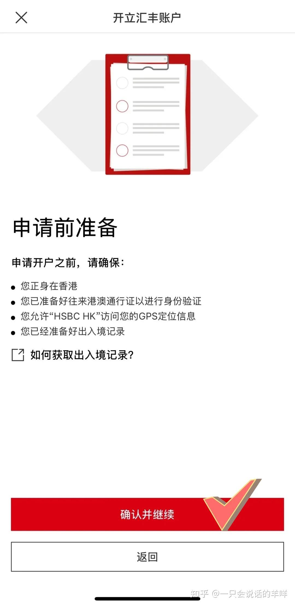

*汇丰开户 7/11*

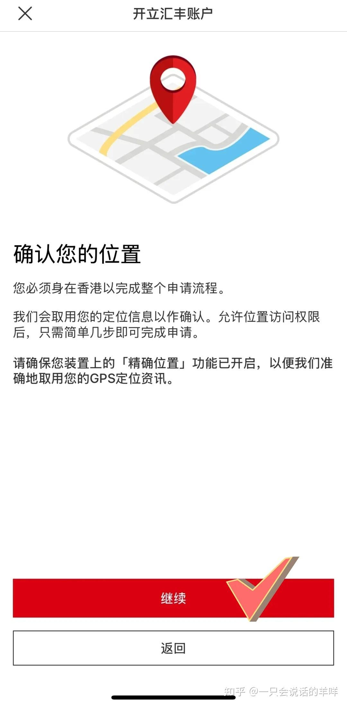

*汇丰开户 8/11*

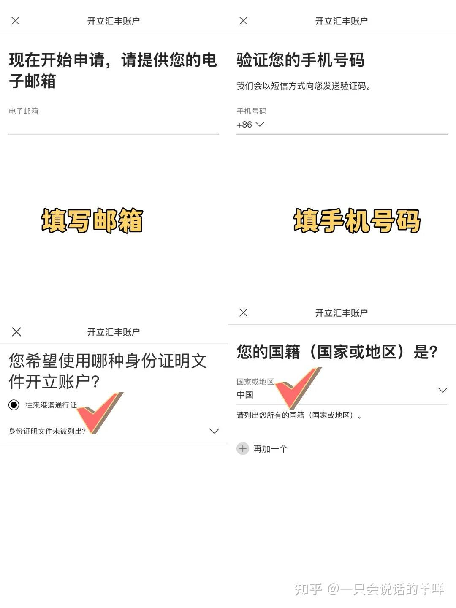

*汇丰开户 9/11*

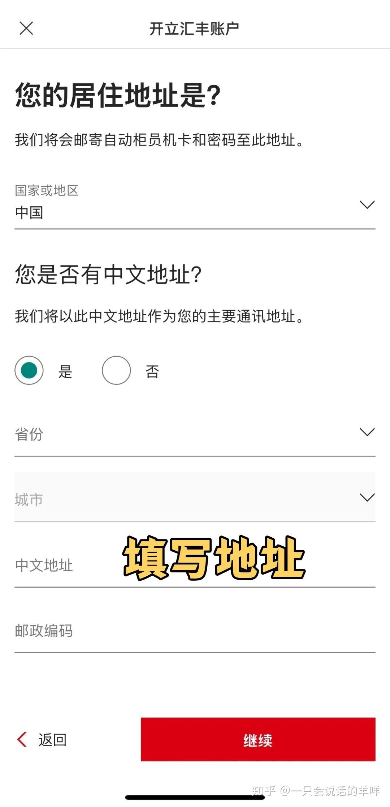

*汇丰开户 10/11*

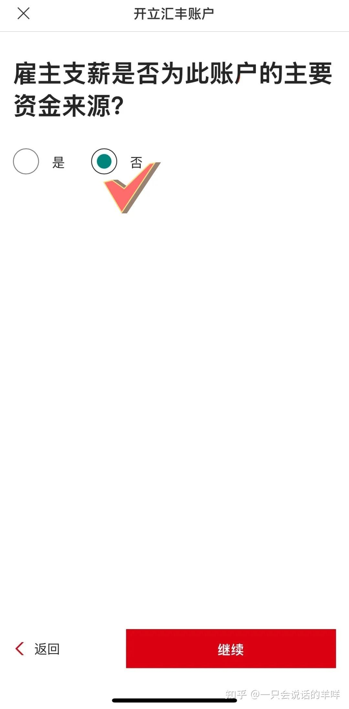

*汇丰开户 11/11*

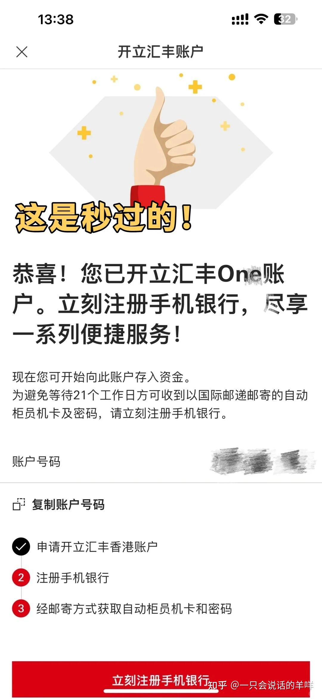

*汇丰开户 12/11*

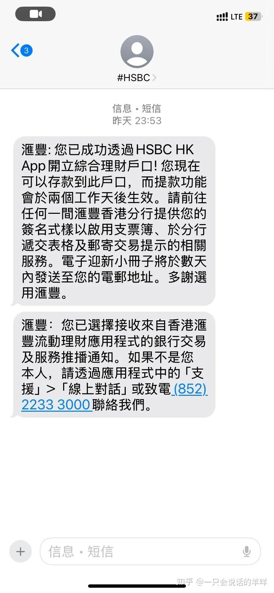

*汇丰开户 13/11*

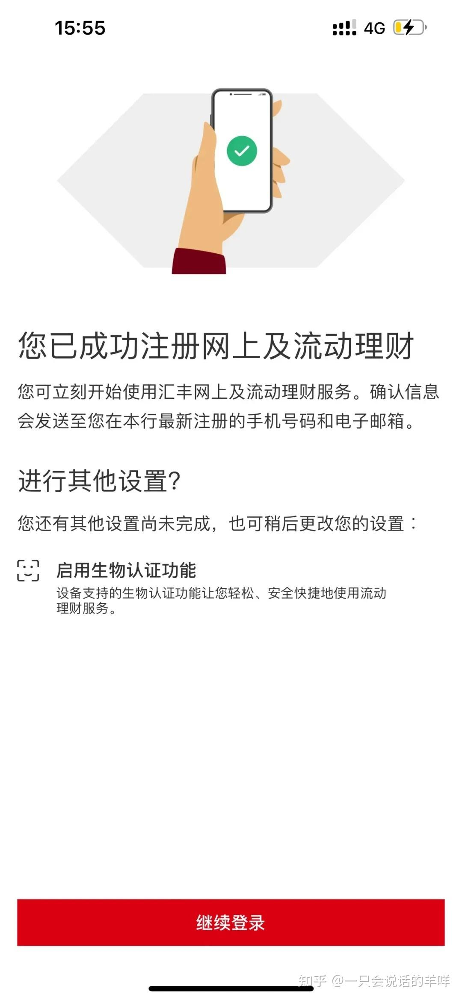

*汇丰开户 14/11*

### ✅ 第三步：身份验证与提交

1. **NFC 识别通行证**：通行证紧贴手机背面摄像头区域，保持光线充足
2. **上传出入境记录 PDF**：**文件名称勿修改**，直接上传
3. **获取参考编号**：提交后系统生成编号，**立即截图保存**——这是后续激活凭证

---

## 四、激活后关键操作

### 收卡与密码函

| 物品 | 方式 | 时效 |
| --- | --- | --- |
| **实体卡（红狮子银联卡）** | EMS 邮寄，可查 EMS 公众号追踪 | 约 7–10 个工作日 |
| **密码函** | **平邮，无物流信息** | 约 4–6 周 |

> 💡 提示：密码函未收到时，可拨打**汇丰内地客服 400 电话**，要求 **DHL 补发**。

### 账户安全设置

- 登录 App →「安全设置」→ 开启**面容 ID 登录**与**交易提醒**

### 转账额度

| 状态 | 额度 |
| --- | --- |
| 初始 | **0**，需手动调整 |
| 手动调整后 | 约 **40 万港币/天** |
| 已登记收款人 | 可升至约 **300 万港币/天** |

### 使用禁忌

| ❌ 不要 | 原因 |
| --- | --- |
| **资金快进快出** | 入账后至少隔一天再转出，防风控 |
| **频繁更换登录设备** | 可能导致账户锁定，需线下解锁 |
| **长期不动户** | 每半年至少交易一次，避免休眠冻结 |

---

## 五、常见问题

**Q：开户被拒怎么办？**
A：常见原因是信息错误、地址不详细、重名审核三种。核对证件有效期与填写一致性；因重名延迟的等邮件通知。

**Q：只有 2 个字的姓名会不会更容易被拒？**
A：值得注意的是**两字姓名**在部分银行更容易触发风控（见 [04 中银香港](04-bank-bochk.md) 也有同样提示）。这是经验观察，**不是"改名就能绕过"的技巧**——保持证件姓名一致才是正路。

**Q：和 [10 蓝狮子](10-card-blue-lion.md) 是什么关系？**
A：蓝狮子是汇丰的**多币种万事达借记卡**，需要先有汇丰 ONE 账户才能申领。

**Q：汇丰 ONE 能做港股券商入金通道吗？**
A：可以，见 [05 入金路径图](../05-funding.md#52-入金路径图)。**注意同一银行同名转账通常更快更省。**

---

## 六、风险与合规提示

| 项 | 说明 |
| --- | --- |
| ✅ **如实填写** | 收入、职业、资金来源一律按实际，KYC 造假是永久黑名单风险 |
| ⚠️ **地址证明要自洽** | 银行流水地址需与通行证/申请表一致 |
| 🚫 **别用 VPN** | 定位漂移会卡审核 |
| 🚫 **别找"包过"中介** | 见 [09 诈骗识别](../09-risks.md#2-诈骗识别清单) |

---

**返回** → [攻略集索引](README.md) · 上一篇 → [02 盈立证券](02-broker-usmart.md) · 下一篇 → [04 中银香港](04-bank-bochk.md)
