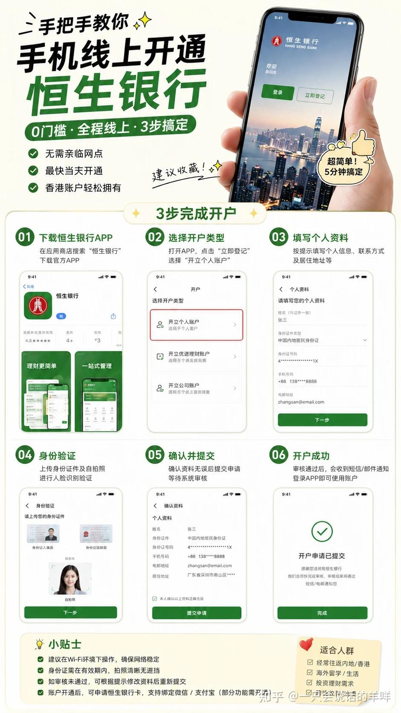

# 05 恒生银行 Mobile App 开户

> 恒生对内地居民开放了 **Mobile App 线上开户**：人在香港、材料齐，10–20 分钟提交，**秒批当场出账号**。

## 机构信息

| 项 | 值 |
| --- | --- |
| 官网 | <https://www.hangseng.com/> |

## ⚠️ 阅读前必读

- 🌐 **网络环境**：部分券商/银行的 App 与开户页面在**内地网络下无法完成提交**（提交转圈、验证码收不到、上传证件失败、"当前地区不支持"）。解法是**全局模式 + 境外节点**，但**居住地址与税务居民身份仍须如实填写**。详见 [13 网络环境](../13-network-environment.md)

1. **硬前提：本人在香港境内**。App 会校验 GPS / 网络定位，**内地打不开入口**。
2. 恒生的开户政策、账户类型与费率会调整。值得注意的是"秒批"，但也可能转人工（2–3 工作日）。
3. 恒生的账户类型有**持续门槛**（如优越理财需 100 万港币），**别选错**。

---

## 一、资格自检（缺一不可）

| # | 条件 | 备注 |
| --- | --- | --- |
| 1 | 年满 18 岁 | — |
| 2 | **本人身处香港** | App 校验 GPS / 网络定位 |
| 3 | 有效《往来港澳通行证》+ 有效签注 | 建议有效期 ≥ 6 个月 |
| 4 | 有内地住宅地址 | 用于填通讯地址 |
| 5 | **手机支持 NFC** | 读通行证芯片（iPhone 7+ / 主流安卓） |
| 6 | 能收验证码的内地手机号 + 常用邮箱 | — |

> 💡 以 App 实际页面校验为准。

---

## 二、材料清单（过关前就备好）

| # | 材料 | 要求 |
| --- | --- | --- |
| 1 | 港澳通行证原件 | 有效期 ≥ 6 个月 |
| 2 | 内地身份证原件 | — |
| 3 | 支持 NFC 的手机 | iPhone 7 以上 / 主流安卓，**记得开 NFC 开关** |
| 4 | 能收短信的手机号 | — |
| 5 | 常用邮箱 | — |
| 6 | **出入境记录 PDF** | 微信搜「**移民局 12367**」→ 中国公民服务 → 出入境记录查询 → 下载 PDF 存手机 |
| 7 | 内地住址 | 身份证地址最稳；不一致需备近 3 个月水电/信用卡账单 |
| 8 | 职业信息 | 公司名（中 + 英文/拼音）、月薪范围、收入来源 |

> 💡 **出入境记录一般入境后半小时左右才同步**，别刚过关就查。查不到就等一等。

---

## 三、开户九步

### Step 1｜下载官方 App

- App Store 搜「**恒生个人流动理财服务 / Hang Seng Bank**」
- 安卓无上架则从**恒生官网**下载 APK
- ⚠️ **别下成「恒生中国」内地版**

### Step 2｜进入开户入口

```
首页 →「快速连结」→「手机开户」→「我要开立恒生综合户口」
```

### Step 3｜选账户类型

| 类型 | 适合 | 说明 |
| --- | --- | --- |
| **优进理财 Preferred** | 普通用户 | ✅ **推荐**：无低额结存费、日常够用 |
| 优越理财 | 资产 100 万港币以上 | 需**持续维持** 100 万港币资产 |

> ⚠️ **别盲目选优越理财**——门槛是持续的，不是一次性。

### Step 4｜拍港澳通行证

- 证件平放、光线好、**四角完整、别反光**
- 系统 OCR 识别后，**核对姓名 / 证件号**

### Step 5｜NFC 读芯片

- 通行证**贴手机背面顶部**
- 失败就：**摘手机壳 → 换角度 → 慢一点**
- iPhone / 安卓都要**先开 NFC**

### Step 6｜人脸自拍

- 不戴帽 / 墨镜 / 口罩
- 背景干净、光线均匀

### Step 7｜上传出入境记录

- 上传「移民局 12367」导出的 PDF

### Step 8｜填写个人资料

| 字段 | 填法 |
| --- | --- |
| 姓名、地址、职业、收入、开户用途 | 如实 |
| 税务居民 | 选**中国**，**TIN 填身份证号** |
| 资金来源 | ⚠️ **别选虚拟货币**，选工资 / 储蓄 / 理财收益 |

### Step 9｜提交 + 登记 e-Banking

- 提交后**可能秒批出账号，也可能转人工**（等 2–3 工作日）
- **别关 App**，接着注册网银：设登录名 + 6 位保安编码
- 约 **2–3 个工作日**后转账 / FPS / 投资功能全开



*恒生：网银注册完成与功能开通*

---

## 四、避坑清单

| ❌ 别做 | 为什么 | ✅ 替代做法 |
| --- | --- | --- |
| 下载非官方 App、找"包过中介" | 骗子公司与封号风险 | 只用官网 / 官方商店 |
| 地址乱填 | 与身份不符会卡审核 | 身份证地址最稳；异地备地址证明 |
| 资金来源选 crypto / 币圈 | 触发反洗钱审查 | 工资 / 储蓄 / 理财收益 |
| 开 VPN | 定位漂移卡审核 | 用真实网络环境 |
| 中途退出 App | 资料**不保存** | 一次性填完 |
| 忘记调转账限额 | 默认限额很低 | 开完立即调高 |
| 首笔入金当天快进快出 | 触发风控 | 隔天再动 |

---

## 五、一句话流程速记

```
人在香港 → 下官方 App → 手机开户 → 拍证 → NFC → 自拍
        → 传出入境记录 → 填资料 → 提交 → 开网银
```

---

## 六、风险与合规提示

| 项 | 说明 |
| --- | --- |
| ✅ **资金来源如实填** | 这是反洗钱审查的第一道门 |
| ⚠️ **"秒批"不保证** | 转人工就等 2–3 工作日 |
| 🚫 **别用 VPN 规避定位** | 属规避审核，风险自担 |
| ✅ **留着开户确认信** | 将来入金/报税都要用 |

---

## 七、恒生与其他选择

| 银行 | 优势 | 适合 |
| --- | --- | --- |
| **恒生**（本篇） | 手机开户最快，秒批 | 想省时间，不想跑分行 |
| **[汇丰](03-bank-hsbc.md)** | ONE 免管理费、全球网点、后续可申蓝狮子 | 想一步到位配齐卡 |
| **[中银香港](04-bank-bochk.md)** | 内地中行同名互转免费 | 内地主力用中行 |
| **[ZA Bank](06-bank-virtual-zabank.md)** | 5 分钟、0 门槛、0 费用 | 纯备用账户 |

> 💡 **建议组合**：主流银行 1 家 + 虚拟银行 1 家，见 [11 新规总表 § 银行选择策略](11-rules-2026.md)。

---

**返回** → [攻略集索引](README.md) · 上一篇 → [04 中银香港](04-bank-bochk.md) · 下一篇 → [06 众安银行](06-bank-virtual-zabank.md)
