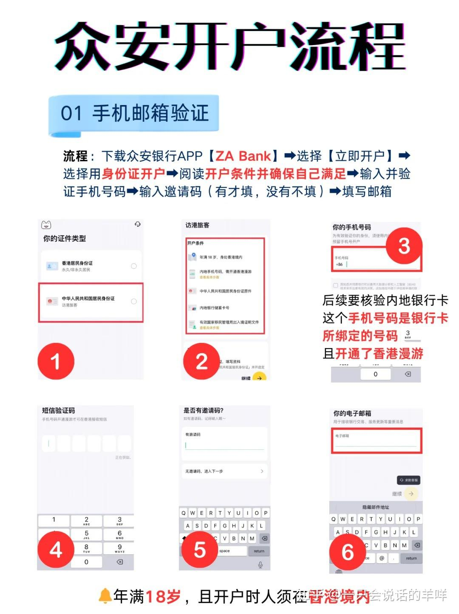
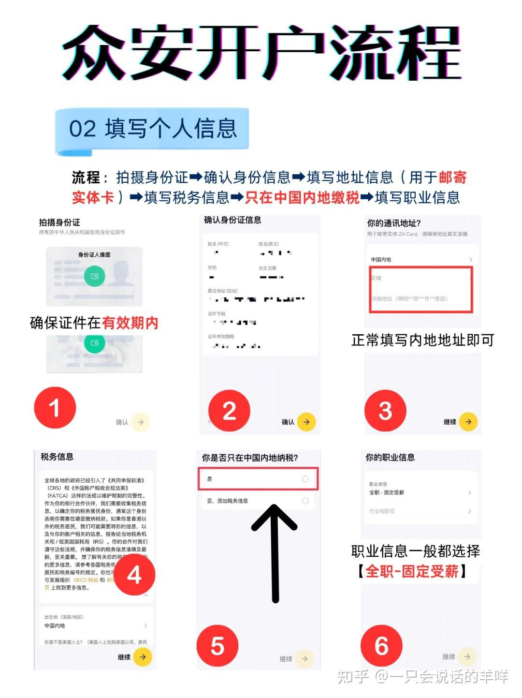

# 06 众安银行 ZA Bank 开户

> 香港虚拟银行。**零门槛、零成本、5 分钟开户**，支持港币/美元/人民币三币种，外汇兑换 0 手续费。

## 机构信息

| 项 | 值 |
| --- | --- |
| 官网 | <https://www.zabank.com/> |
| **法定名称** | 眾安銀行有限公司 / ZA Bank Limited |
| **SFC 中央編號** | **BOJ557** |

## ⚠️ 阅读前必读

- 🌐 **网络环境**：部分券商/银行的 App 与开户页面在**内地网络下无法完成提交**（提交转圈、验证码收不到、上传证件失败、"当前地区不支持"）。解法是**全局模式 + 境外节点**，但**居住地址与税务居民身份仍须如实填写**。详见 [13 网络环境](../13-network-environment.md)

1. **必须本人在香港**，App 会检测 IP + GPS。
2. **两字姓名用户审核更慢**（据称三字通常秒过、两字可能需 1–3 工作日），这是经验观察，非规则。
3. 虚拟银行是**你的补充通道，不是主通道**。金额大的资金建议仍配一家传统银行，见 [11 新规总表](11-rules-2026.md)。

---

<a id="promo-06-zabank"></a>

> 💡 **用邀请码开户更快**：带上邀请码 `R36W28` 进入，**开户审核更快、通过率更高**。

## 一、为什么选众安

| 优势 | 说明 |
| --- | --- |
| **零门槛零成本** | 无最低存款、无账户管理费、无年费，实体卡免年费 |
| **三币种** | 港币 / 美元 / 人民币，**外汇兑换 0 手续费** |
| **支付生态** | 可绑定支付宝 / 微信支付 / Apple Pay |
| **对境外平台友好** | 与加密货币、Wise 等平台兼容性好；**港股券商出入金 0 手续费** |

> 💡 "对加密货币友好"是**技术兼容性**的描述，**不代表使用加密货币出入金是合规的**。见 [08 税务与合规 § 外汇红线](../08-tax-compliance.md#5-外汇管理红线)。

---

## 二、材料清单与五大避坑

### ✅ 必备材料

| 材料 | 要求 |
| --- | --- |
| 内地身份证 | 有效期 > 30 天，无磨损、反光 |
| 港澳通行证 | **签注页在开户当天有效**，有效期 > 30 天（需同时拍**个人信息页 + 签注页**） |
| 内地银行储蓄卡 | **一类卡**，预留手机号与开户手机号一致 |
| 开通国际漫游的手机号 | 接收验证码（移动/联通/电信均可，免费开通） |
| 电子版出入境记录 | 微信「移民局」小程序下载 PDF，**需含本次赴港记录** |

<a id="zabank-5-pitfalls"></a>

### ⚠️ 五大避坑

| # | 坑 | 正确做法 |
| --- | --- | --- |
| 1 | **定位问题** | 需身处香港（检测 IP + GPS）。用**香港 SIM 卡**或**内地卡开漫游流量**（**禁用 Wi-Fi**） |
| 2 | 证件拍摄失败 | 通行证**签注页易识别失败**，光线均匀环境下多角度拍摄 |
| 3 | **姓名拼音** | 系统自动生成英文名，**务必核对**（如"吕"需为 "Lyu" 而非 "Lu"） |
| 4 | 实体卡邮寄 | **内地地址需付 35 港币邮费**（香港地址免费），建议开户后立即申请 |
| 5 | 审核时效 | 三字姓名通常秒过；两字可能需 1–3 工作日（**离港后仍可补材料**） |

---

## 三、开户五步（5 分钟极速版）

### 📍 Step 1｜下载 App 与网络准备

1. 抵港后连接本地网络（推荐购买香港流量包）
2. 应用商店搜索「**ZA Bank**」下载（安卓可官网下 APK）
3. 开户链接可带邀请码 `R36W28`

### 📱 Step 2｜启动开户流程

1. 点击「**立即开户**」→ 选择「**中华人民共和国居民身份证**」
2. **输入内地手机号** → 接收短信验证码



*ZA Bank：立即开户 → 身份证 → 手机号验证*

### 🆔 Step 3｜证件拍摄与验证

1. **身份证正反面**：平放，四角入框，无反光
2. **港澳通行证**：重点对准**签注页有效期**
3. **人脸识别**：按提示眨眼 / 摇头（勿戴帽子、眼镜）

### 📝 Step 4｜填写个人资料

| 字段 | 填法 |
| --- | --- |
| 通讯地址 | 内地详细住址（用于收实体卡） |
| 税务信息 | 选「**是，在中国内地缴税**」 |
| 职业与开户目的 | 「储蓄」或「个人财务」即可 |



*ZA Bank：个人资料与税务信息填写*

### 🔐 Step 5｜设置账户与提交

1. 设定用户名 + 密码（**英文字母 + 数字组合**）
2. 绑定内地储蓄卡（卡号 + 短信验证）
3. 上传「移民局」出入境记录 PDF
4. 提交申请，等待审核短信

---

## 四、开户后必做

### 1. 激活实体卡

```
APP →「ZA Card」→「立即领取」→ 自选卡号后 6 位（可选）
    → 支付邮费 → 10 个工作日内寄达
```

### 2. 提升转账额度

| 状态 | 额度 |
| --- | --- |
| 初始：转自己账户 | HKD 5 万/日 |
| 初始：转他人 | HKD 1 万/日 |
| **提额技巧** | 从他行同名账户转入一笔资金 → 额度升至 **HKD 30 万/日** |

> 💡 **这个提额技巧值得记住**——先从别的银行同名账户汇一笔钱进来，额度就开了。

### 3. 成本对比：取现

| 场景 | 成本 |
| --- | --- |
| **香港 ATM 取港币** | ✅ **0 手续费** |
| 内地 ATM 取人民币 | 每笔 HKD 50 + 1.95% 汇率费 |

> 💡 建议：**绑定移动支付消费**，比内地 ATM 取现划算得多。绑卡方法见 [10 蓝狮子 § 绑定内地支付](10-card-blue-lion.md#blue-lion-bind-payment)。

---

## 五、常见问题

**Q：众安能直接给券商入金吗？**
A：值得注意的是与港股券商出入金 **0 手续费**。但**入金通道的可行性以你选的券商当前政策为准**——很多券商不收虚拟银行账户的入金。见 [05 入金路径图](../05-funding.md#52-入金路径图)。

**Q：虚拟银行能开投资账户吗？**
A：[WeLab](07-bank-virtual-welab.md) 明确支持（且**必须在香港境内当场开通**，回内地无法补开）。**ZA Bank 请以 App 内实际入口为准。**

**Q：ZA Bank 和 WeLab 怎么选？**
A：见 [11 新规总表 § 虚拟银行](11-rules-2026.md)。

**Q：离港后才发现资料有问题怎么办？**
A：据称**离港后仍可补材料**，但审核与补件会变慢，**建议尽量一次通过**。

---

## 六、风险与合规提示

| 项 | 说明 |
| --- | --- |
| ⚠️ **虚拟银行是补充不是主力** | 单一平台的限额与功能都不如传统行 |
| ⚠️ **休眠** | 长期不动户可能被限制，见 [03 账户维护](../03-hk-account.md#5-账户维护与年费) |
| 🚫 **别用它做不受监管的资金归集** | 虚拟货币、代汇等一律不行 |
| ✅ **核对自动生成的英文名** | 拼错会导致后续股息与税务文件出错 |

---

**返回** → [攻略集索引](README.md) · 上一篇 → [05 恒生银行](05-bank-hang-seng.md) · 下一篇 → [07 汇立银行](07-bank-virtual-welab.md)
