# 07 汇立银行 WeLab Bank 开户

> 香港金管局发牌的 8 家数字银行之一。**纯线上、最快 5 分钟、0 门槛、0 费用**，新客福利是它最大的卖点。

## 原文信息

| 项 | 值 |
| --- | --- |
| 来源 | <https://zhuanlan.zhihu.com/p/2009603499395155739>（专栏 `c_1967646104905581431`） |
| 原标题 | 汇立银行（WeLab Bank）开户流程全图文：5 分钟搞定！ |
| 作者 | 一只会说话的羊咩 |
| 本篇整理 | 2026-11-05 |
| 官网 | <https://www.welab.bank/> |

---

## ⚠️ 阅读前必读

- 🌐 **网络环境**：部分券商/银行的 App 与开户页面在**内地网络下无法完成提交**（提交转圈、验证码收不到、上传证件失败、"当前地区不支持"）。解法是**全局模式 + 境外节点**，但**居住地址与税务居民身份仍须如实填写**。详见 [13 网络环境](../13-network-environment.md)

1. **必须身处香港境内**，App 需定位权限确认。
2. **投资账户必须在香港境内当场开通，回内地无法补开**——这是原文强调的关键点，也是最容易漏掉的一步。
3. 新客福利（加息券、现金奖赏）**有期限与门槛**，请以官网当前活动为准。
4. 原文含推荐码 `FPNJ3F`，是否使用请自行判断。

---

## 一、平台背景

| 项 | 说明 |
| --- | --- |
| 牌照 | 香港金融管理局发牌的 **8 家数字银行之一** |
| 股东背景 | 长江 TOM 集团、红杉资本、建银国际等 |
| 核心优势 | 纯线上操作、快速开户、福利多 |

### 六大优势

| # | 优势 | 说明 |
| --- | --- | --- |
| 1 | **极速开户** | 最快 5 分钟完成全流程，不用去实体分行排队 |
| 2 | **零费用门槛** | 无最低存款、无账户管理费、无开户手续费 |
| 3 | **安全保障** | 受**香港存款保障计划**保护，最高保额 **80 万港币** |
| 4 | **全球通用** | 虚拟万事达借记卡，可绑 Apple Pay / 微信 / 支付宝 |
| 5 | **高收益活动** | 新户多重福利，含高息定存与现金奖励 |
| 6 | **投资账户** | 可开通证券投资功能（**须在港当场开通**） |

> 💡 存款保障计划：银行倒闭时存款人最高可获赔 80 万港币。这是香港本地银行的法定机制。

---

## 二、开户前必备材料

### 核心证件

- **内地居民身份证**原件
- **港澳通行证**（确保签注有效）

### 关键凭证：出入境记录

- 微信「**移民局 12367**」小程序下载 PDF
- ✅ 记录需显示**开户当日或之前**的出境日期
- ✅ 证件号码必须与**港澳通行证**一致
- ❌ **不接受护照入境记录**

### 辅助准备

| 项 | 要求 |
| --- | --- |
| 手机漫游 | 开通可接收短信的国际漫游（必需） |
| 地址信息 | 完整居住地址，**含楼层和单位号，不可用商业地址** |
| 网络环境 | 建议连接**香港本地 Wi-Fi** |

---

## 三、开户八步

### 第一步｜下载 App

- iOS：App Store 搜「**汇立银行**」或「**WeLab Bank**」
- Android：Google Play 或官网下载 APK

### 第二步｜启动开户流程

1. 打开 App，点击「**开立账户**」
2. 选择证件类型：「**内地居民身份证**」
3. **允许 App 访问定位权限**（确认身处香港境内）

### 第三步｜身份验证

1. 输入手机号 + 邮箱，获取短信验证码
2. 拍摄身份证正反面（**清晰、无反光**）
3. 完成人脸识别（不可遮挡面部）

### 第四步｜上传出入境记录

从手机文件中选择提前下载的 **PDF** 上传

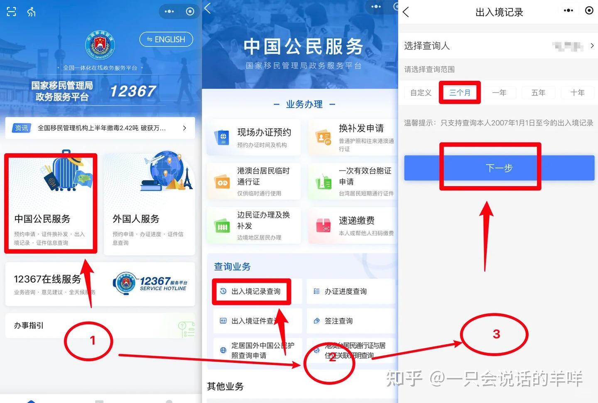

*WeLab：上传出入境记录 PDF*


### 第五步｜设置账户信息

1. 自定义登录用户名与密码
2. 设置 **6 位交易密码**
3. 填写详细居住地址
4. 完善职业信息与开户目的（原文建议选「**投资**」）

<details open>
<summary>📸 原文截图：账户信息填写（3 张）</summary>

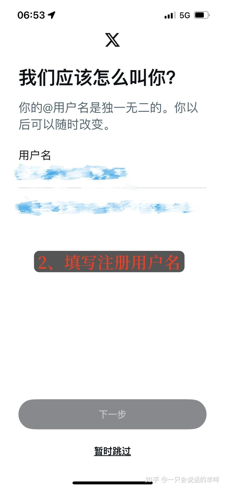

*WeLab：设置账户信息*

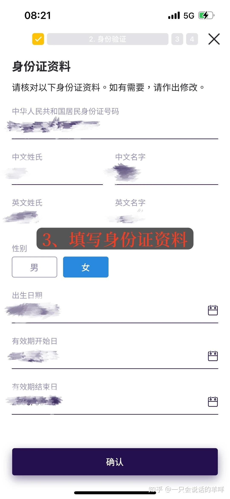

*WeLab：填写居住地址*

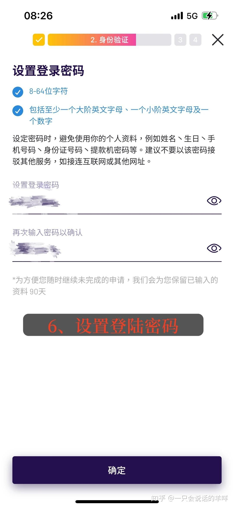

*WeLab：职业信息与开户目的*

</details>


### 第六步｜填写推荐信息

推荐码栏输入原文的 `FPNJ3F`（可自行决定是否使用）

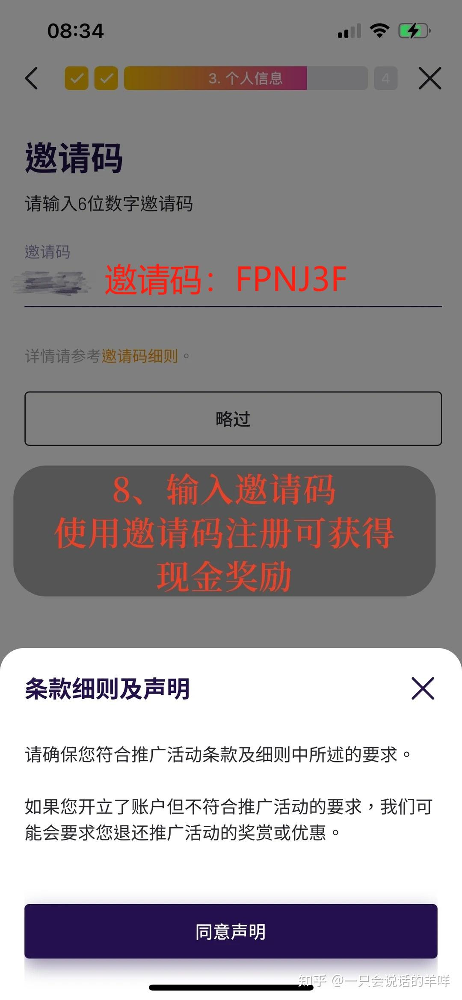

*WeLab：推荐码填写*


### 第七步｜⭐ 开通投资账户

> **原文强调：在香港境内立即开通投资账户，回到内地后将无法补开。**
> 只需完成简单的风险评估问卷即可。

<details open>
<summary>📸 原文截图：开通投资账户（2 张）</summary>

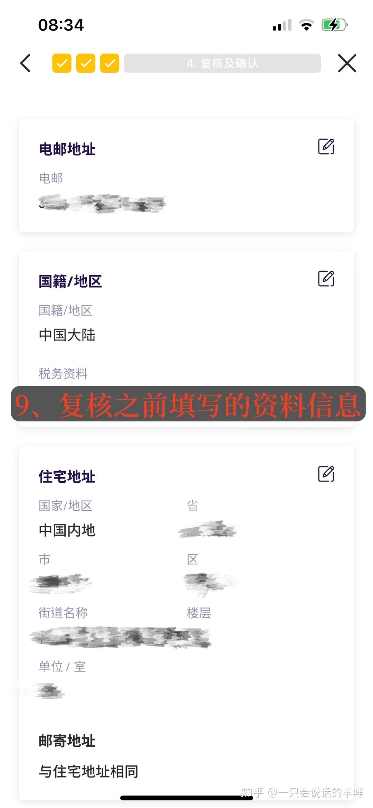

*WeLab：开通投资账户入口*

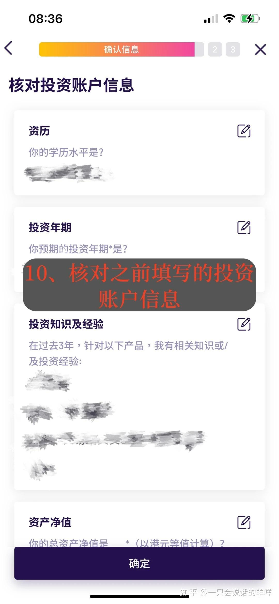

*WeLab：风险评估问卷*

</details>


这一步与你的**港股券商入金通道**直接相关——见 [05 入金路径图](../05-funding.md#52-入金路径图)。

### 第八步｜提交申请

核对信息后提交，通常 **1–2 个工作日**收到审核结果通知

---

## 四、新客专属福利

| 类型 | 原文描述 |
| --- | --- |
| **20% 高息定存加息券** | 适用于 7 天港元定存，本金 1 万–10 万港币 |
| **现金奖赏** | 开户后 **30 天内**存入 ≥ 1 万港币并维持 30 天 → **100 港币** |
| **理财加码赏** | 满足上述条件 + 完成一笔 ≥ 1 万港币的合资格基金交易 → **额外 100 港币** |

### 特色服务

| 服务 | 说明 |
| --- | --- |
| **全球汇款 0 手续费** | 从香港汇款到内地、美国及其他海外地区免手续费 |
| **货币兑换最低保证** | 港美兑换低汇率，单笔 10 万港币以上"买贵包赔" |
| **万事达卡 2% 返现** | 每月平均余额 > 5 万港币，消费满 100 港币即享 2% 返现 |

> ⚠️ **返现类活动的常见条件**：需在 App 内登记活动、每月刷满笔数、有上限封顶、活动随时结束。**先注册再消费**，否则事后补登很麻烦（[10 蓝狮子](10-card-blue-lion.md) 里就有返现漏发的实操记录）。

---

## 五、常见问题

**Q：开户收费吗？**
A：**完全免费**，无开户费、管理费、最低存款要求。

**Q：审核要多久？**
A：通常 1–2 个工作日。**两字姓名**可能更慢（见 [06 ZA Bank § 避坑](06-bank-virtual-zabank.md#zabank-5-pitfalls)）。

**Q：能把卡绑到内地支付宝/微信吗？**
A：可以，完整步骤见下方 [§ 六、绑卡附录](#六附把汇立借记卡绑到内地支付宝--微信)。

**Q：虚拟银行的本金安全吗？**
A：香港持牌虚拟银行受金管局监管，存款受**存款保障计划**保护（最高 80 万港币）。

**Q：能用它给券商入金吗？**
A：先确认你的券商**当前是否接受虚拟银行入金**——不少券商有白名单。见 [05 入金路径图](../05-funding.md#52-入金路径图)。

---

## 六、附：把汇立借记卡绑到内地支付宝 / 微信

> 来源：知乎专栏 `c_1967646104905581431`《汇立银行卡（WeLab Bank）绑定支付宝/微信全攻略｜图文版》
> **这是同一专栏的第 2 篇**，与本篇开户流程配套使用。

### 6.1 绑定前准备

1. **下载内地版**支付宝 / 微信（**不是** AlipayHK / WeChat Pay HK）
2. **获取卡片信息**：汇立 APP →「银行卡」→「卡资料」→ 记下**卡号、有效期、安全码**
3. **确保实名认证**：支付宝 / 微信需完成实名认证才能绑卡

### 6.2 支付宝绑定

```
支付宝 → 我的 → 银行卡 → 右上角「+」→ 输入卡号
      → 填写有效期与安全码 → 同意协议并添加 → 输入短信验证码
```

<details open>
<summary>📸 原文截图：支付宝绑定（2 张）</summary>

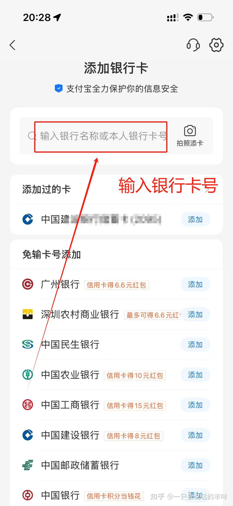

*WeLab：支付宝绑卡 - 添加银行卡*

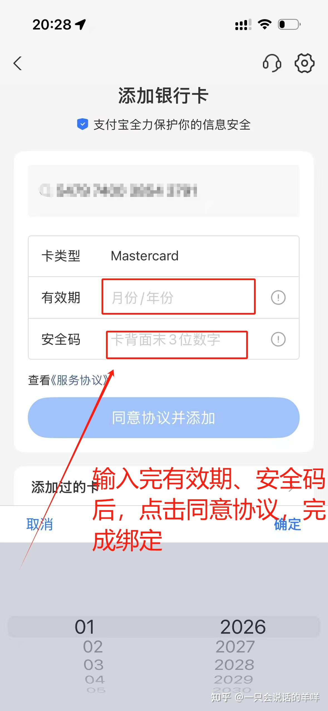

*WeLab：支付宝绑卡 - 填写卡片信息*

</details>

### 6.3 微信支付绑定

```
微信 → 我 → 服务 → 钱包 → 银行卡 → 添加银行卡
    → 输入支付密码验证身份 → 输入卡号
    → 填写卡片信息 → 下一步 → 输入短信验证码
```

<details open>
<summary>📸 原文截图：微信绑定（3 张）</summary>

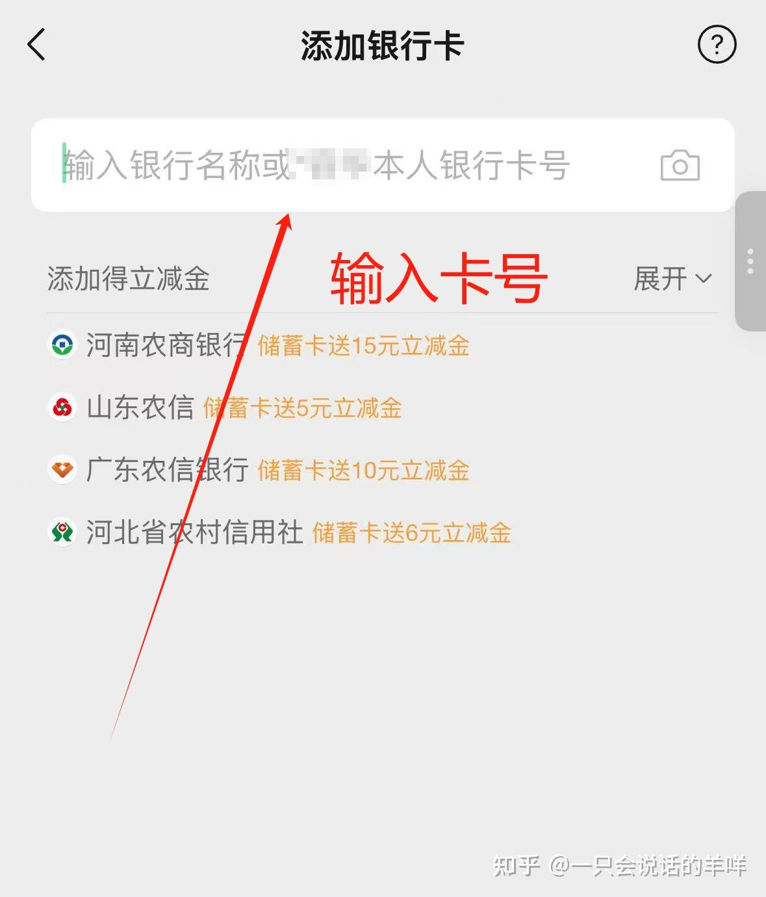

*WeLab：微信绑卡 - 银行卡入口*

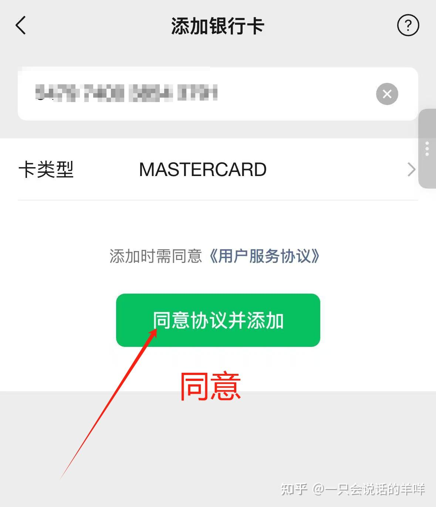

*WeLab：微信绑卡 - 输入卡号*

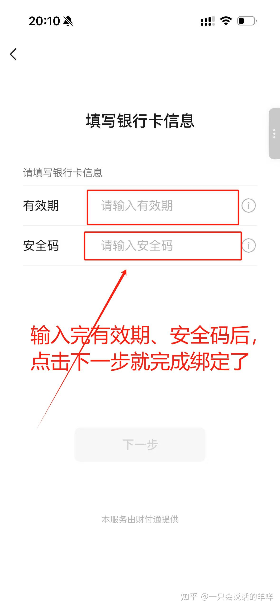

*WeLab：微信绑卡 - 短信验证*

</details>

### 6.4 绑定后的优势

| 优势 | 说明 |
| --- | --- |
| **人民币直接扣款** | 避免港币结算的汇率损失 |
| **0 外币兑换手续费** | 汇立提供人民币 $0 外币兑换及交易手续费 |
| **最低汇率保证** | 汇立提供有竞争力的低汇率 |
| **消费现金回赠** | 绑定后消费另有回赠 |

### 6.5 ⚠️ 注意事项

| 项 | 说明 |
| --- | --- |
| **支付限额** | 境外卡单笔限额 6,000 元，月累计 5 万，年累计 6 万 |
| **手续费** | 单笔 ≤ 200 元免手续费，> 200 元收 3% 手续费 |
| **优先付款** | 绑卡后记得在支付设置中设为优先付款方式 |

### 6.6 💡 小贴士

1. **汇率锁定**：提前在汇立 APP 兑换人民币，锁好汇率再消费
2. **双钱包策略**：保留港版钱包用于本地消费，内地钱包专门用于跨境支付
3. **定期检查**：每月检查绑定状态与交易记录

> ⚠️ **用途边界**：绑卡做**个人消费**没问题；🚫 但**不要用他人卡替别人过账、换汇**，那实质上是个人换汇，见 [08 外汇管理红线](../08-tax-compliance.md#5-外汇管理红线)。

---

## 七、风险与合规提示

| 项 | 说明 |
| --- | --- |
| ✅ **第 7 步别漏** | 投资账户必须在港当场开 |
| ⚠️ **福利有成本** | "存入并维持 30 天"意味着资金被占用，别为薅羊毛压住本住的流动性 |
| 🚫 **不要为凑活动门槛做无意义交易** | 见 [07.3 最低收费陷阱](../07-fees.md#73-最低收费陷阱) |
| ✅ **保存活动规则截图** | 事后申诉要靠它 |

---

**返回** → [攻略集索引](README.md) · 上一篇 → [06 众安银行](06-bank-virtual-zabank.md) · 下一篇 → [08 兴业寰宇卡汇款](08-transfer-swift.md)
