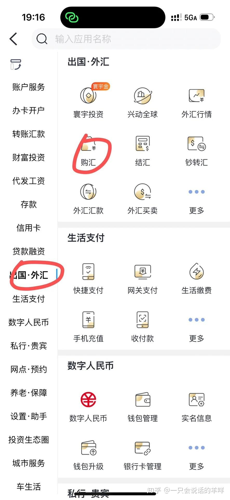
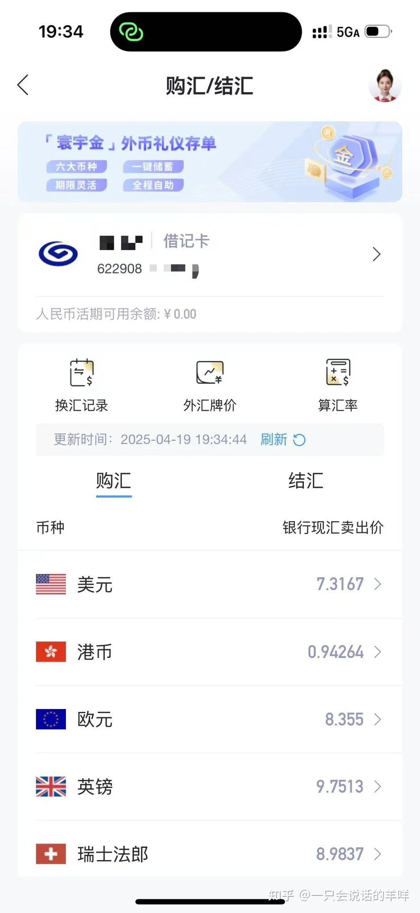
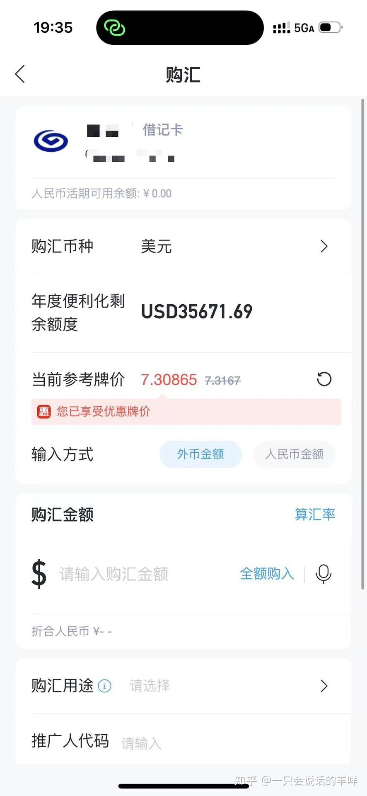
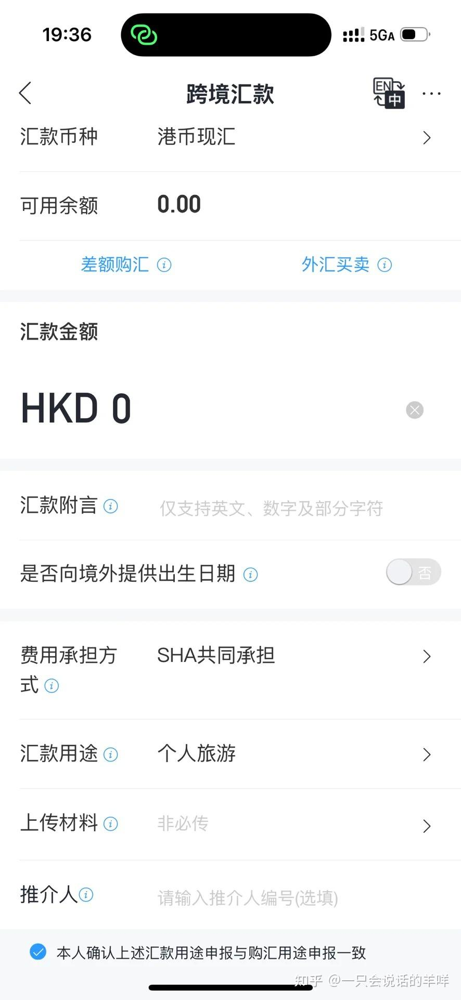
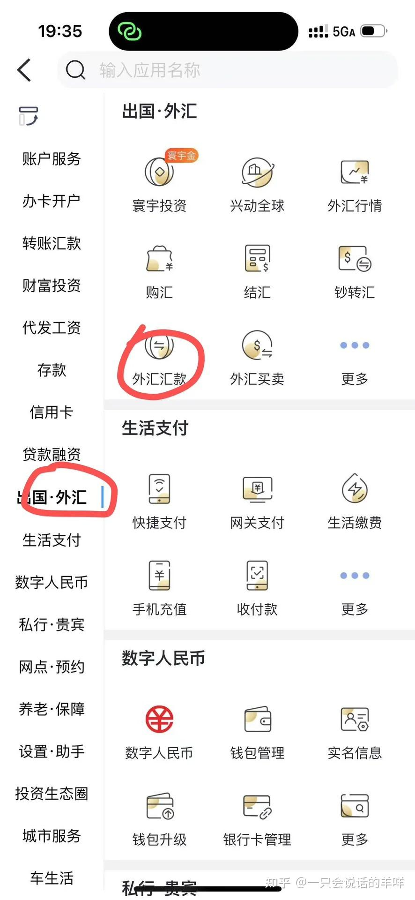
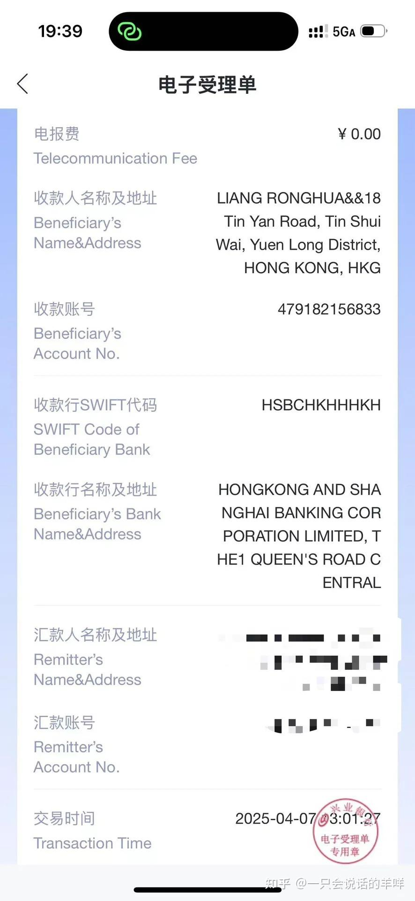

# 08 内地汇款到香港：兴业寰宇卡 + SWIFT 电汇

> 用内地兴业银行「寰宇人生卡」把人民币换成港币/美元电汇到香港，单笔手续费与电讯费可做到 0，汇率享中间价折扣。

## 原文信息

| 项 | 值 |
| --- | --- |
| 来源 | <https://zhuanlan.zhihu.com/p/1913555428534650200>（专栏 `c_1967646104905581431`） |
| 原标题 | 兴业寰宇卡无损转账香港汇丰全攻略：手把手教学 + 避坑指南 |
| 作者 | 一只会说话的羊咩 |
| 本篇整理 | 2026-11-05 |
| 官网 | <https://www.cib.com.cn/> |

---

## 🚫 必读：原文有一处踩了红线，本篇已更正

原文在两处建议**把用途申报成与实际不符的理由**：

| 原文建议 | 🚫 问题 |
| --- | --- |
| 购汇用途选「**因私旅游**」，汇款附言写「LV YOU」 | 你的实际用途是**证券投资**。用途申报与实际不符，等于向银行提供虚假信息 |
| 开卡用途填「**跨境旅游**」或「留学缴费」，避免「炒股」字样 | 同上。用"避开敏感词"的方式填表，本质还是不实申报 |

**本手册的立场**（见 [08 税务与合规 § 外汇管理红线](../08-tax-compliance.md#5-外汇管理红线)）：

```
✅ 用途申报「因私旅游」→ ❌ 错误
✅ 用途申报「证券投资」 → ✅ 正确
```

**为什么不能按原文来**：
1. **银行要与你的实际交易流水对账。** 购汇写"旅游"、汇出后资金进的是证券账户，流水一对就自相矛盾。
2. **银行会做真实性审核。** 用途不实的汇款在柜面复核时可能被要求补充证明（券商开户证明、对账单），拿不出就退回。
3. **这属于向金融机构提供虚假信息**，可能触发外汇违规处理：降额、列入关注名单、限制外汇业务。
4. **银行风控是交叉比对。** 你的购汇记录、汇款附言、券商账户名称、后续结汇申报是能串起来的。

> 💡 **实操结论**：正确做法反而更简单——**用途就写"证券投资"，前后保持一致**。银行看到你有真实券商账户和证明材料时，通过率比"编旅游"更高。见 [05 入金 § 用途怎么写](../05-funding.md#513-用途怎么写)。

> 💡 **一个真实的额外好处**：原文建议的"以最低汇率购汇"仍然可用，**但请在购汇环节就选"证券投资"**。

---

## 一、为什么选兴业寰宇人生卡

| 优势 | 说明 |
| --- | --- |
| **前 30 笔跨境汇款免手续费 + 电讯费** | 原文注明优惠延续至 2025-06-30 且历史常年续期，**当前是否延续需自行核实** |
| **钞转汇 0 成本** | 普通卡现钞转现汇需额外费用，寰宇卡直接豁免 |
| **中转行费用规避** | 兴业与汇丰直连，SWIFT 代码填对可避免中转行扣费（原文称经美国中转可能扣 $20–100） |
| **汇率优势** | 购汇/结汇享**中间价折扣**。原文实测（购 1 万港币）：兴业 ¥9321 / 中行 ¥9331 / 招行 ¥9333；100 美元点差 1.375，低于工行 3.11、招行 3.15 |
| **到账快** | 工作日上午 9:00–11:00 操作通常当天到账；非工作日或下午提交延至 T+1 |

> ⚠️ 原文的汇率对比是**某一时点的实测值**，不是承诺。中行、招行、汇丰也有自己的优惠活动（见 [09 跨境支付通](09-crossborder-payment.md)），**汇款前横向比价**。

---

## 二、寰宇人生卡申请

### 方式 1：线上申请（已有兴业卡）

1. 下载「**兴业银行 APP**」→ 搜索「**寰宇借记卡**」
2. 选「**换卡**」（保留一类账户权限）或「**新卡申请**」（邮寄到家）
3. 填写邮寄地址 + 激活分行（**需同省**），3–5 工作日收卡
4. 带身份证 + 旧卡（换卡用户）到网点**激活**，重设密码

> ⚠️ **关键**：**新开卡默认二类账户（无法购汇）**，需通过"换卡"维持一类权限。**激活需在 180 天内完成**，超期要重新申请。

### 方式 2：线下网点办理（新用户）

- **材料**：仅身份证原件（部分网点需社保记录，建议提前电话确认）
- ⚠️ **用途申报**：按实际用途填写。**涉及购汇能力的用途申报以银行要求为准，不要用"避开敏感词"的方式填写**——见本文开头的红线说明
- **限额**：新卡默认日限 ¥5,000–20,000；存 30 万理财可升级白金卡提额

---

## 三、跨境汇款全流程

### Step 1｜购汇（人民币 → 港币 / 美元）

1. APP 搜索「**购汇**」→ 进入「**结售汇**」
2. 选择币种：**优先港币**（原文认为用途解释更合理）
3. 输入金额
4. ⚠️ **用途**：选「**证券投资**」（如银行有更细分的证券类选项，选对应的那个）
5. 确认汇率优惠提示 → 点击「确认购汇」
6. ⚠️ **务必选「现汇」**——**现钞无法转账**

<details open>
<summary>📸 原文截图：购汇流程（3 张）</summary>



*兴业：进入「结售汇」*



*兴业：选择币种与金额*



*兴业：确认购汇与汇率优惠*

</details>


> 💡 **先开户再购汇**：手里有券商的开户确认信和对账单，银行做真实性审核会快得多。见 [05 入金 § 购汇与额度](../05-funding.md#51-购汇与年度便利化额度)。

### Step 2｜填写跨境汇款信息

| 栏目 | 填写规范 | ⚠️ 注意 |
| --- | --- | --- |
| **汇款附言** | 英文大写，**与购汇用途保持一致**（如 `SECURITIES INVESTMENT`） | 🚫 **不要写与实际用途不符的旅游/学费字样** |
| **费用承担方** | 选「**SHA 共同承担**」 | 选 OUR 会**冻结 ¥200** |
| **汇款人英文名** | 拼音大写，姓与名之间空格，如 `WANG DACHUI` | 与本人证件拼音一致 |
| **收款人账户** | 汇丰 **12 位账号**（**不是银行卡号**），在 APP 内「账户详情」查看 | 填错会退汇 |
| **收款人地址** | 具体到门牌号的香港英文地址 | ⚠️ 原文强调：填「香港迪士尼酒店」这类**不够具体**的地址可能被退 |
| **SWIFT 代码** | 汇丰：`HSBCHKHHHKH`（填后自动关联收款行地址） | 见下方代码表 |
| **代理行代码** | 同样填 `HSBCHKHHHKH` | 避免中转行扣费 |

<details open>
<summary>📸 原文截图：跨境汇款填写（3 张）</summary>



*兴业：跨境汇款信息填写*



*兴业：手续费显示为 0*



*兴业：电子回单*

</details>


### Step 3｜提交与跟踪

- 核对**手续费显示为 0** → 确认提交
- 保存**电子回单**（路径：APP → 跨境汇款 → 查看受理单）
- 到账查询：汇丰 APP「账户概览」实时刷新，通常 **1 个工作日内**到账

---

## 四、高频问题避坑

### 1. 转账额度低怎么办？

- 新卡**前 3 个月**日限 ¥4,000–5,000
- 满 3 个月后 APP 自助提额：
  ```
  搜索「调额」→ 转账限额 → 非柜面交易限额 → 输入目标额度（最高可调至 ¥5 万/日）
  ```

### 2. 汇款被驳回的常见原因

| 原因 | 说明 |
| --- | --- |
| 地址未具体到门牌号 | 写"香港迪士尼酒店"等可能被退 |
| **分拆汇款** | 单日多笔小额易触发风控，**建议单笔顶额转**（🚫 注意：跨境分拆购汇是违规的，见 [05 § 限额速查](../05-funding.md#56-限额速查表)） |
| 收款名与开户名拼音不一致 | 严格核对大小写和空格 |

### 3. 美元汇款的额外注意事项

- 需**提前在汇丰 APP 购汇 $1 生成美元账户**，否则自动兑港币有汇损
- 非工作时间汇款可能经美国中转行，产生 $20–100 费用

---

## 五、香港主流银行 SWIFT 代码表

| 银行名称 | SWIFT Code | Bank Code |
| --- | --- | --- |
| 香港汇丰银行 | `HSBCHKHHHKH` | 4 |
| 中国银行（香港） | `BKCHHKHHXXX` | 12 |
| 渣打银行 | `SCBLHKHH` | 3 |
| 恒生银行 | `HASEHKHHXXX` | 24 |
| 星展银行 | `DHBKHKHH` | 16 |

> 更多代码见兴业 APP「跨境汇款」页面的自动联想功能。

---

## 六、两条路怎么选：电汇 vs 跨境支付通

| 维度 | SWIFT 电汇（本篇） | 跨境支付通（下一篇） |
| --- | --- | --- |
| 到账速度 | 1 个工作日（上午操作可当天） | **秒到账** |
| 手续费 | 寰宇卡前 30 笔免（需核实） | 试点期主流银行全免 |
| 汇率 | 银行现汇卖出价（享折扣） | 实时汇率 |
| 收款方限制 | 几乎所有境外银行 | **限 6 家香港银行**（恒生、工银亚洲、汇丰、中银香港、东亚、建银亚洲） |
| **额度性质** | 占用**年度 5 万美元便利化额度** | 占用**年度 5 万美元额度**（南向） |
| **用途限制** | 按实际用途申报 | ⚠️ **适用场景为个人消费/旅游/生活费等，不含证券投资** |

> ⚠️ **重要区分**：跨境支付通的**南向汇款官方适用场景是个人消费、旅游购物、在港生活费**，**不是证券投资**。如果你要把钱汇去开港美股账户，走的是本篇的**电汇 + 证券投资用途申报**这条路。两条通道不能互相替代。

---

**返回** → [攻略集索引](README.md) · 上一篇 → [07 汇立银行](07-bank-virtual-welab.md) · 下一篇 → [09 跨境支付通](09-crossborder-payment.md)
