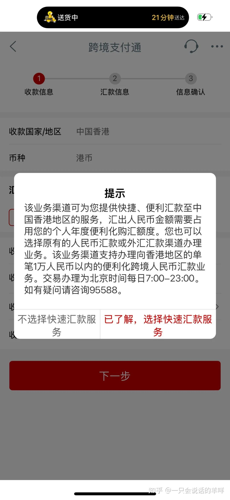
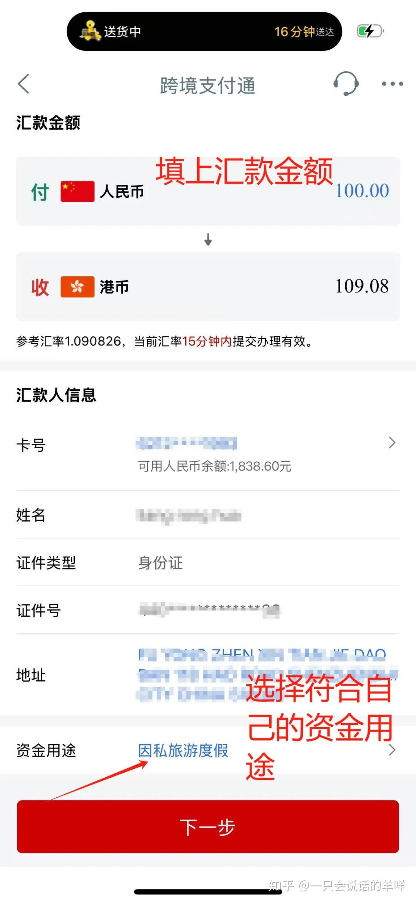
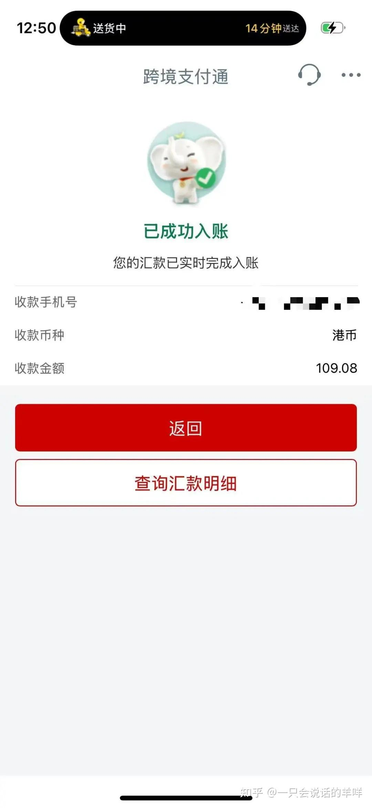
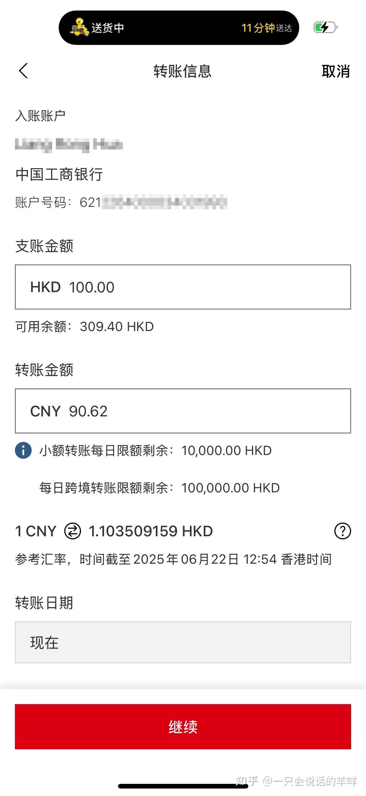
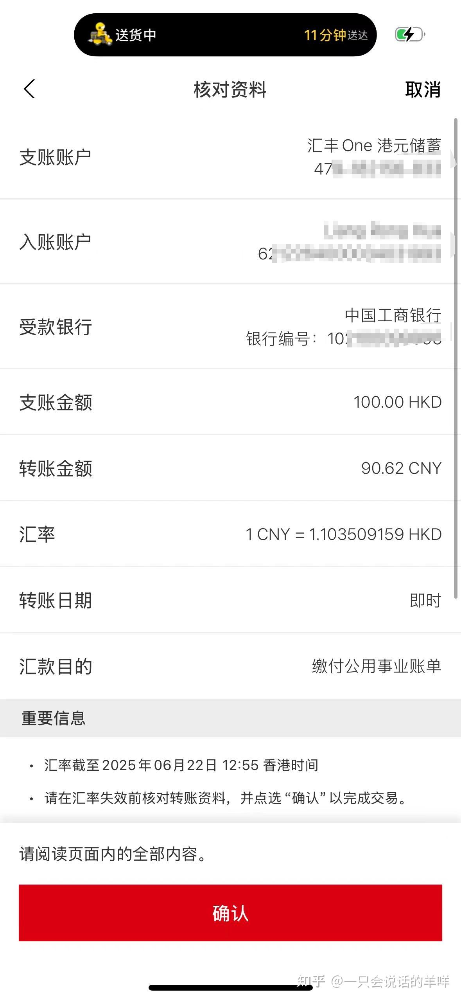

# 09 跨境支付通：人民币 ↔ 港币实时互转

> 中国人民银行 × 香港金管局 2025-06-22 联合推出的跨境支付系统，直连内地**网上支付跨行清算系统（IBPS）**与香港**转数快（FPS）**。**秒到账、零手续费。**

## 原文信息

| 项 | 值 |
| --- | --- |
| 来源 | <https://zhuanlan.zhihu.com/p/1923146974200312971>（专栏 `c_1967646104905581431`） |
| 原标题 | 一文读懂跨境支付通 \| 附图文教程 |
| 作者 | 一只会说话的羊咩 |
| 本篇整理 | 2026-11-05 |

---

## ⚠️ 阅读前必读

1. ⚠️ **这是"支付"通道，不是"证券投资"通道。** 官方列明的南向场景是**个人消费、旅游购物、在港生活费**。**如果你要把钱汇去开港美股账户、买证券，走的是 [08 SWIFT 电汇 + 证券投资用途申报](08-transfer-swift.md)。**
2. **试点期免手续费**，但**后续可能收费**。原文提到建行、农行等承诺"长期保持低费率"，**以各家银行最新公告为准**。
3. **参与银行是白名单制**，不是所有银行都支持。原文称收款银行**限 6 家**（恒生、工银亚洲、汇丰、中银香港、东亚、建银亚洲）。
4. 原文的**奖励活动有明确时间窗**（如 6.22–8.31、至 9.30），**均已过期**，此处保留其形式供参考。

---

## 一、它是什么

| 项 | 说明 |
| --- | --- |
| **上线** | 2025 年 6 月 22 日，中国人民银行与香港金融管理局联合推出 |
| **底层** | 直连内地 IBPS（网上支付跨行清算系统）↔ 香港 FPS（转数快） |
| **能力** | **人民币与港币实时互转** |
| **解决什么** | 传统跨境汇款流程复杂、耗时长 |

### 核心优势

| 优势 | 说明 |
| --- | --- |
| **秒到账** | 资金实时到账 |
| **零手续费** | 试点期间主流银行全免（工行、招行、汇丰等） |
| **操作极简** | 只需对方**手机号或银行账号**，无需 SWIFT 代码 |
| **汇率透明** | 实时汇率，无隐形汇差 |

---

## 二、谁能用

| 方向 | 适用人群 |
| --- | --- |
| **南向（内地 → 香港）** | 持**内地身份证** / 军人证件 / 武警证件的内地居民 |
| **北向（香港 → 内地）** | 持**香港身份证**的香港居民 |

> ⚠️ **关键限制**：北向汇款**必须用香港身份证开户的账户**，**内地身份证开立的港卡无效**。

### 三类支持场景

| 场景 | 说明 |
| --- | --- |
| **南向汇款（内地 → 香港）** | 用途：个人消费、旅游购物、在港生活费等。币种：人民币汇出，可选人民币或港币到账。**限额：占用每年 5 万美元外汇额度，单日 ≤ 30 万人民币** |
| **北向汇款（香港 → 内地）** | 用途：在深消费、亲友转账、内地投资等。币种：港币/人民币汇出，人民币到账。**限额：单日 ≤ 1 万港元，全年 ≤ 20 万港元（不占用同名汇款额度）** |
| **机构对个人业务** | 用途：**留学缴费**（如香港大学学费）、**医疗缴费**、**薪资发放**、公共事业缴费。支持双边本币或人民币 |

---

## 三、四步完成实时汇款（南向示例）

### 1️⃣ 登录最新版手机银行

- 打开工行 / 农行 / 中行 / 招行等 APP（**需更新至最新版本**）
- 搜索「**跨境支付通**」进入功能页

*跨境支付通：手机银行功能入口*

### 2️⃣ 填写收款信息（关键！）

| 字段 | 填法 |
| --- | --- |
| **姓名** | **全拼大写**（如 `ZHANG SAN`） |
| **手机号** | 直接填**香港手机号**（无需 +852） |
| **地址** | **倒序英文填写**（如 `NO.12 NANSHAN ST, SHENZHEN`） |
| **收款银行** | 限 6 家：恒生、工银亚洲、汇丰、中银香港、东亚、建银亚洲 |
| **到账币种** | **建议选港币**（香港日常消费更通用） |

### 3️⃣ 输入金额并确认汇率

- 系统自动显示**实时汇率（15 分钟内有效）**
- 用途按实际选择（南向为消费/旅游/生活费类）

*跨境支付通：金额、汇率与用途*

### 4️⃣ 提交并查收

- 确认后**资金秒到账**，可截图通知收款人

*跨境支付通：提交成功*

> 💡 **北向操作差异**：通过香港银行 APP（中银香港、汇丰香港等）进入「跨境支付通至内地」界面，流程类似但**支持 24 小时汇款**。

📸 原文截图：北向（香港→内地）（2 张）

*跨境支付通：香港端「至内地」入口*

*跨境支付通：北向转账界面*

---

## 四、避坑指南

### 1. 为什么转账失败？

| 原因 | 说明 |
| --- | --- |
| **身份不符** | 北向汇款必须用**香港身份证开户**的账户，内地身份证开立的港卡无效 |
| **超限额** | 香港 → 内地超 **1 万港元/日** 会失败 |
| **服务时间外** | 内地 → 香港**仅限 7:00–23:00**；香港 → 内地**全天可用** |

### 2. 手续费会一直免费吗？

- **试点期免手续费**（原文称截至 2025 年 8–9 月，各银行不同）
- 后续可能收费，**建行、农行等已承诺"长期保持低费率"**

### 3. 奖励活动盘点（原文记录，**均已过期**）

| 银行 | 活动 |
| --- | --- |
| 建银亚洲 | 设为默认收款行，单笔转 1,000+ 港元/人民币 → 100 港元奖励（6.22–8.31） |
| 汇丰香港 | 收 1,000+ 港元/人民币 → 10 港元奖励（至 9.30） |

> 💡 **这类"设默认收款行"的返现活动值得留意**——即便过期，也可能以其他形式回归。

---

## 五、南北向关键差异速查

| 项目 | 南向（内地 → 香港） | 北向（香港 → 内地） |
| --- | --- | --- |
| **操作方向** | 内地居民向香港汇款 | 香港居民向内地汇款 |
| **适用人群** | 内地身份证持有者 | 香港身份证持有者 |
| **服务时间** | 每日 7:00–23:00 | **24 小时** |
| **单日限额** | ≤ 30 万人民币 | ≤ 1 万港元 |
| **全年限额** | 占用 5 万美元外汇额度 | ≤ 20 万港元（**不占用同名汇款额度**） |
| **到账币种** | 人民币或港币 | 人民币 |
| **是否占外汇额度** | ✅ 占 | ❌ 不占（同名汇款） |

---

## 六、怎么和你的港美股投资组合起来

### ✅ 适合用跨境支付通的

| 场景 | 说明 |
| --- | --- |
| **在港日常生活费** | 学费、房租、吃饭、购物 |
| **在港亲友转账** | 与家人朋友之间 |
| **保障账户有日常流水** | 账户长期零交易可能被判定为休眠 |
| **北向** | 香港身份持有人把资金调回内地 |

### ❌ 不适合用跨境支付通的

| 场景 | 原因 | 替代方案 |
| --- | --- | --- |
| **给港美股券商账户入金** | 官方场景不含证券投资 | [08 SWIFT 电汇 + 证券投资用途申报](08-transfer-swift.md) |
| **大额跨境搬家** | 单日 30 万人民币上限 | 电汇或银行柜面 |
| **以"投资"为名但实际不是** | 用途不符 | 🚫 不要用 |

> 💡 **组合思路**：把跨境支付通当**生活通道**（低费率、实时、日常），把 SWIFT 电汇当**投资通道**（用途合规、可大额）。两者各司其职。

---

**返回** → [攻略集索引](README.md) · 上一篇 → [08 兴业寰宇卡汇款](08-transfer-swift.md) · 下一篇 → [10 汇丰蓝狮子](10-card-blue-lion.md)
