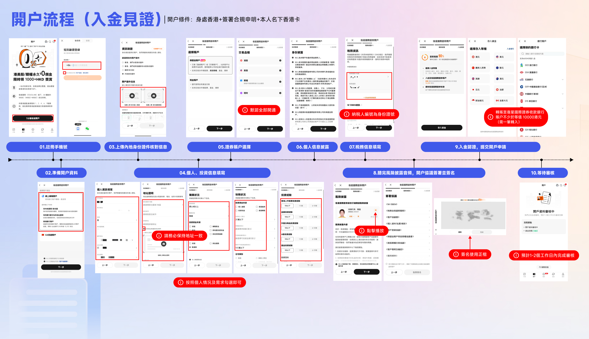

# 12 复星国际证券（Fosun International Securities）港股开户

> 复星系持牌券商，SFC 第 1/2/4/9 类牌照。本篇汇总主体资质、开户路径与推广通道。

## 主体信息

| 项 | 值 |
| --- | --- |
| **法定名称** | 復星國際證券有限公司 / Fosun International Securities Limited |
| **SFC 中央編號** | **AAF432** |
| **牌照类型** | 第 1 类（证券交易）、第 2 类（期货合约交易）、第 4 类（就证券提供意见）、第 9 类（资产管理） |
| **注册地址** | 香港中环花园道 3 号冠军大厦 2101-2105 室 |
| **集团背景** | 复星国际（香港 00656.HK）旗下金融服务平台 |
| **查询方式** | <https://apps.sfc.hk/publicregWeb/> → 搜索 "Fosun International" 或 "AAF432" |

> 📎 **本篇流程图与十步说明由作者提供**（官方《开户流程（入金见证）》流程图），已按简体重排为文字步骤，方便读者检索。

> ✅ **查牌照是必做动作。** 同集团不同持牌法团的产品条款、费率、资产隔离方式都不同。**以你开户时签署的《客户协议》上的持牌法团名称为准**，而不是以 App 名字或推广页名字为准。

---

## 🎁 邀请码与开户链接

<a id="promo-12-fosun"></a>

> **本节为推广位。** 本仓库与下方机构存在推广合作，你使用邀请码/链接开户会给作者带来返佣。**返佣来自机构，不来自你，不影响你的费率与合规性**；作者不因返佣改变上文对流程与风险的判断。

| 项目 | 内容 |
| --- | --- |
| **邀请码** | `CYYB5C` |
| **开户邀请链接** | [点击进入开户页](https://hk.usmartbroker.com/marketing/mgm-poster/mgm-lottery17.html?langType=1&ICode=vv44x&inviteName=&id=20240612002&bizId=20240612002&shareId=promotion&register-ct=m&register-cid=hk-2022-aug&avatar=#/pages/startAccount.html?channel=040003&aeCode=B2&invitationCode=CYYB5C&langType=zhCn) |
| **推荐人** | 一只会说话的羊咩（跨境金融 KOL） |

### 开户邀请链接

```text
https://hk.usmartbroker.com/marketing/mgm-poster/mgm-lottery17.html?langType=1&ICode=vv44x&inviteName=&id=20240612002&bizId=20240612002&shareId=promotion&register-ct=m&register-cid=hk-2022-aug&avatar=#/pages/startAccount.html?channel=040003&aeCode=B2&invitationCode=CYYB5C&langType=zhCn
```

> 📎 **建议直接复制这段完整链接**（含 `#` 后的参数）使用，否则邀请码参数可能丢失。链接较长，也可只用邀请码 `CYYB5C` 手动填写。

> ⚠️ **请注意链接域名**：该链接托管在 `hk.usmartbroker.com`（uSmart 盈立的 WebApp 营销平台域名）上。**这不代表你开的是盈立的账户**——最终以开户确认信与《客户协议》上的持牌法团名称为准。**拿到开户确认信后，先核对名称是不是「復星國際證券有限公司 / Fosun International Securities Limited（AAF432）」。**

### 为什么建议用邀请码 / 邀请链接开户？

| 好处 | 说明 |
| --- | --- |
| **开户成功率更高** | 走推广通道进入的申请会带上**推荐人标识**。客服与合规侧能直接看到你的渠道归属，信息传递链路更顺，**被当成"来源不明的陌生申请"反复补件的概率更低** |
| **开户速度更快** | 推广通道的申请在人工复核队列里**渠道可识别**，资料齐全时通常 **1–3 个工作日**完成，而不是来回补件拖到一周以上 |
| **专属新人礼遇** | 部分机构对带邀请码的新客户有额外费率折扣、赠金或活动名额 |
| **问题可追溯** | 通过推荐关系开户，遇到卡审核时更容易找到对应的客服/合规接口推动 |

> ⚠️ **开户前先向客服确认三件事**（这一步能省掉后续扯皮）：
> 1. 使用邀请码 `CYYB5C` 后的**默认佣金率与最低收费**具体是多少？**有没有比不用邀请码更差？**
> 2. 邀请码对应的**优惠内容、门槛与有效期**分别是什么？
> 3. **不使用邀请码会不会被拒绝开户？**（正常情况下不会——邀请码只影响归属与优惠，不影响你的开户资格）
>
> 以上"成功率更高 / 速度更快"是**推广方口径**，请以上面三个问题的官方回复为准。

---

## 一、开户准备清单

| # | 材料 | 要求 |
| --- | --- | --- |
| 1 | 内地居民身份证 | 彩色扫描/拍照，四角完整无反光 |
| 2 | 港澳通行证 或 护照 | 有效期 ≥ 6 个月 |
| 3 | **住址证明** | 近 3 个月银行对账单 / 水电账单，需含姓名 + 完整地址 + 日期 |
| 4 | 手机号 | 能收国际短信 |
| 5 | 邮箱 | 常用邮箱，用于接收对账单与税务文件 |
| 6 | 职业与收入信息 | 按实际填写，用于 KYC |
| 7 | 税务资料 | 中国税务居民，**TIN 填身份证号**；如开美股权限需签 W-8BEN |

> 📎 住址证明的具体做法与踩坑清单见 [02 行前准备](../02-prepare.md)。

---

## 二、开户条件

<div align="center">

**开户流程（入金见证）**

**开户条件：身处香港 + 签署合规申明 + 本人名下香港卡**

</div>

| 条件 | 说明 |
| --- | --- |
| **身处香港** | ⚠️ **硬性前提**，开户申请需在**香港境内**提交 |
| **签署合规申明** | 流程第 8 步，需**听完风险披露音频**后签署开户协议并签名 |
| **本人名下香港卡** | 流程第 9 步的入金验证，需**本人名下**的香港银行账户 |
| **入金门槛** | 账户**不少于等值 10,000 港元**（需**一笔转入**，非累计） |

> ⚠️ **"一笔转入 ≥ 10,000 港币"是最容易卡人的一步。** 它不是"账户里累计有 1 万就行"，而是**一次性转入**到复星国际证券的**指定收款银行**。资金一旦汇错账户类型（转成他人账户、转成非本人同名账户）**会被退回且耗时数个工作日**。开户前先确认好收款人姓名与账号。

---

## 三、开户流程（十步）

> 依据官方《开户流程（入金见证）》流程图整理，**以 App 实际页面为准**（版本更新会调整措辞）。

```
01 註冊手機號  →  02 準備開戶資料  →  03 上傳內地身份證件核對信息
     ↓                                      ↓
09 入金驗證，提交開戶申請  →  10 等待審核（1-2 個工作日）
     ↓
04 個人、投資信息填寫  →  05 證券賬戶選擇  →  06 個人信息披露
     ↓
07 稅務信息填寫  →  08 聽完風險披露音頻，開戶協議簽署並簽名
```

| 步 | 操作 | 关键提示 |
| --- | --- | --- |
| **01** | **注册手机号** | App 内注册。宣传口径为港美股/期货永久 $0 佣金、1000+ HKD 奖金、**5 分钟通过开户** |
| **02** | **准备开户资料** | 线上开户用**内地身份证 + 港澳通行证**；需开通 CA 认证账户 |
| **03** | **上传内地身份证件核对信息** | 登记邮箱、拍证件照并核对证件信息。⚠️ **请务必保持地址一致** |
| **04** | **个人、投资信息填写** | 地址证明、职业、投资经验、税务居民、资产等，**按个人情况及需求勾选即可** |
| **05** | **证券账户选择** | 现金账户 / 保证金账户 / 虚拟账户 |
| **06** | **个人信息披露** | 身份验证 + 投资信息。⚠️ **税务人编号填为身份证号**；需准备 **W-8BEN 资料** |
| **07** | **税务信息填写** | 税务居民身份等 |
| **08** | **听完风险披露音频，开户协议签署并签名** | ⚠️ **签名使用正楷**（不要连笔、不要花体） |
| **09** | **入金验证，提交开户申请** | 选择存入货币与银行；**账户不少于等值 10,000 港元（需一笔转入）**；**须转至复星国际证券收款银行** |
| **10** | **等待审核** | **预计 1–2 个工作日内完成审核** |



*复星国际证券：开户流程（入金见证）十步全图*

### 三个最容易踩的坑

| 坑 | 说明 | 应对 |
| --- | --- | --- |
| **地址不一致** | 流程图第 3 步明确警示「请务必保持地址一致」——身份证、申请表、住址证明三处地址必须能对上 | 全部统一，见 [02 行前准备](../02-prepare.md) |
| **签名用花体** | 第 8 步要求「签名使用正楷」，花体/连笔可能被判定为签名不符而退回 | 找一张白纸**手写正楷**签名，再上传 |
| **入金转错账户** | 第 9 步要求转至**复星国际证券的收款银行**，且需**一笔 ≥ 10,000 港币** | 转账前**逐字核对收款人姓名与账号**；建议小额试转一笔确认路径通，再补足 |

### 账户类型怎么选

| 类型 | 适合 | 提醒 |
| --- | --- | --- |
| **现金账户** | 只做现货 | 需全额付款，不能融资 |
| **保证金账户** | 融资、打新、期权等完整功能 | 杠杆带来强制平仓风险，见 [09 风险](../09-risks.md#风险-2市场风险--高必然存在) |
| **虚拟账户** | 特定市场/产品 | 以 App 内实际说明为准 |

> 💡 **建议直接开保证金账户**，后期升级比一开始选现金再申请省事。但**开通后先只用现货功能**，别一上来就加杠杆。

---

## 四、开户后

```
[ ] 核对开户确认信上的持牌法团名称（必须是 AAF432 复星国际证券）
[ ] 核对佣金率、最低收费、平台费、提现费（完整费率表）
[ ] 绑定香港银行账户作为入金通道
[ ] 首次入金并确认到账
[ ] 确认可交易品种（港股 / 美股 / 衍生品）
[ ] 设置 2FA
[ ] 确认股息派发与税费代扣方式
```

---

## 五、风险与合规提示

| 项 | 说明 |
| --- | --- |
| ✅ **核对持牌法团名称** | 收到开户确认信后，第一件事是核对持牌法团与牌照编号 |
| ⚠️ **平台合规政策会变** | 境外券商向内地居民展业存在监管敏感度，见 [09 风险 § 平台合规与清退](../09-risks.md#风险-1平台合规与清退风险--高) |
| 🚫 **别用别人的账户** | 账户不得转借；也别帮别人代持、代操作 |
| 🚫 **别为"返佣"多存钱** | 返佣比例再高，也不值得把应急资金放进去 |
| ✅ **保留证据** | 开户全过程、费率表、活动规则截图留档 |

---

**返回** → [攻略集索引](README.md) · 上一篇 → [11 港卡新规总表](11-rules-2026.md) · 下一篇 → [13 澳门蚂蚁银行](13-bank-ant-macau.md)
