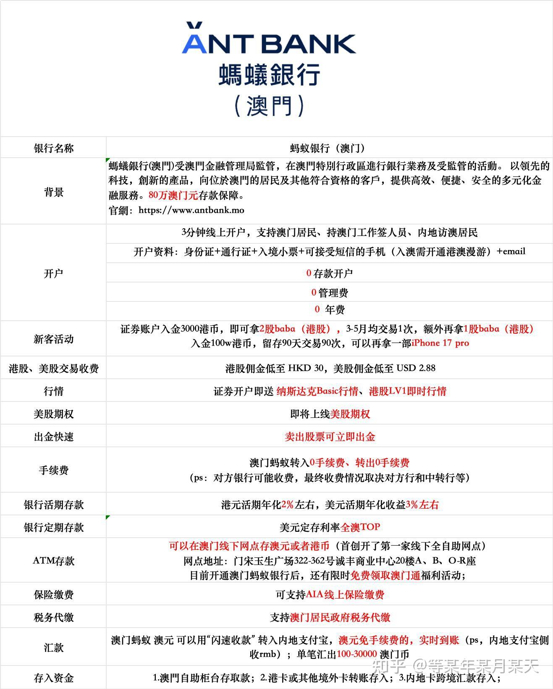
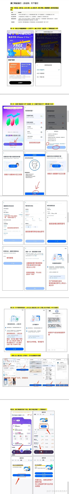

# 13 澳门蚂蚁银行（Ant Bank (Macao)）开户

> 澳门金管局发牌的持牌银行。**人在澳门、线上就能开，最快 3 分钟提交**；开完就是一个**境外银行账户 + 一个可直接交易港美股的投资账户**。

---

> ✅ **查牌照**：在 AMCM 名单中确认「Ant Bank (Macao) Limited」在列。
> 📎 **官方资质说明**：螞蟻銀行（澳門）受澳門金融管理局監管，在澳門特別行政區進行銀行業務及受監管的活動，以領先的科技、創新的產品，向位於澳門的居民及其他符合資格的客戶提供多元化金融服務。

<a id="promo-13-antmacau"></a>

> 💡 **用邀请码开户更快**：带上邀请码 `LPUC8SWD` 或走[开户邀请链接](https://render.alipay.com/p/c/180020570000149153/index.html?invite-code=LPUC8SWD) 进入，**开户审核更快、通过率更高**。
>
> ⚠️ **顺序很重要**：**先通过邀请链接完成注册，再下载 App**，否则邀请关系拿不到。

## 一、为什么值得开

切入角度很实在：**2025 年去澳门的旅客约 3500 万人次，和香港差不多**。很多人假期去澳门旅游，顺手就能开一个境外卡 + 投资账户。

**核心价值**：一张卡同时给你三样东西——

| # | 功能 | 说明 |
| --- | --- | --- |
| 1 | **投资账户：交易港股 + 美股** | 实时行情，账户内直接下单，不用再单独开券商账户 |
| 2 | **境外银行账户** | 支持大部分跨境汇款，是资金出海的通道之一 |
| 3 | **跨境转入转出 0 手续费** | ⚠️ **对方银行、中转行可能有费用，以最终收费情况为准** |
| 4 | **澳门币实时免费到内地支付宝（RMB）** | 日常资金调度方便 |
| 5 | **澳门存取现金** | ⚠️ **目前仅支持港币、澳门币存取** |
| 6 | **实体网点** | 宋玉生广场 322–362 号诚丰商业中心 20 楼，可存钱取钱、去澳门消费也方便 |

---

## 二、开户条件

官方页面写明：

> **最快 1 分钟开户，无门槛，无费用，支持线上开户**；符合开户条件的用户**需要在澳门**才能进行开户申请。

| 条件 | 说明 |
| --- | --- |
| **人在澳门** | ⚠️ **硬性前提**。这是本篇与其他篇最大的不同——多数港资银行是"人在港 + App 远程"，本行是**人在澳门** |
| **证件** | 内地居民身份证 + 港澳通行证（签注有效） |
| **地址证明** | 近 3 个月住址证明 |
| **出入境记录** | 证明合法入境澳门 |
| **手机** | 流程截图中提及需 iPhone / 主流安卓机型 |

> ⚠️ **别忽略"人在澳门"这一条。** 要专门安排一次行程，成本与时间要提前算进去。

---

## 三、开户流程

> ⚠️ 以下按流程图整理，**以官方 App 实际页面为准**（版本更新会调整措辞）。

```
第一步  注册登记
  └─ 先用邀请链接完成注册，再下载 App（顺序不能反）
      ↓
第二步  开户四步（App 内）
  ① 新户专享 → 选择开户类型
  ② 证件类型选择 → 设置登录密码
  ③ 填写邮箱 → 设置 6 位交易密码
  ④ 身份认证（人脸）→ 绑定手机号码
      ↓
第三步  填写职业与税收居民信息
      ↓
第四步  打开「蚂蚁」App → 开通【证券账户】
      ↓
第五步  绑定银行账户 / 授权资金账户（交易账户）
      ↓
开户完成 → 查看开通结果
```

### 详细步骤

| 步骤 | 操作 | 注意 |
| --- | --- | --- |
| **① 注册登记** | 用[邀请链接](https://render.alipay.com/p/c/180020570000149153/index.html?invite-code=LPUC8SWD)注册后，再下载 App | ⚠️ **顺序不能反**，否则拿不到邀请关系 |
| **② 证件类型选择** | 选「中华人民共和国居民身份证」，按提示拍摄 | 四角完整、无反光 |
| **③ 设置密码** | 登录密码 + 6 位交易密码 | 交易密码**别用生日或连续数字** |
| **④ 身份认证** | 人脸识别，按提示眨眼/摇头 | 环境光线充足、不遮挡面部 |
| **⑤ 绑定手机号** | 内地手机号，能收验证码 | — |
| **⑥ 职业与税收居民** | 按实际填写 | ⚠️ **税务居民身份影响股息预扣**，中国税务居民选 China，**TIN 填身份证号** |
| **⑦ 开通证券账户** | App 内「蚂蚁」→ 开通【证券账户】 | 这是**账户内直接交易港美股**的功能 |
| **⑧ 绑定资金账户** | 绑定银行账户 / 授权资金账户（交易账户） | 打通入金通道 |



*图 1｜澳门蚂蚁银行功能介绍（截图）*



*图 2｜澳门蚂蚁银行（证券）开户全流程：注册 → 开户四步 → 开户信息填写 → 开通证券账户 → 授权资金账户（截图）*

---

## 四、入金福利

下列权益**具体以活动页面与客服答复为准，福利条款会变**：

| # | 福利 | 条件 |
| --- | --- | --- |
| 1 | **2% 存款加息券** | 银行侧存款加息 |
| 2 | **转账汇款手续费补贴** | **最高补贴 200 港币** |
| 3 | **最多 3 股阿里巴巴（BABA）港股** | 见下方阶梯 |

### 送股阶梯

| 阶段 | 条件 | 奖励 |
| --- | --- | --- |
| 第一档 | **入金 3000 港币**，10 个工作日内 | **2 股 BABA（港股）** |
| 第二档 | **4–6 月内，每月均交易 1 次**达标 | **再送 1 股 BABA（港股）** |
| **合计** | — | **3 股 BABA** |
| 🎁 大额档 | **入金 100 万港币**，留存 90 天 + 交易 90 次 | **iPhone 17 Pro 256G** |

> ⚠️ **算一笔账再决定要不要为福利入金**：
> - 3 股 BABA 价值大约在**几百到一两千港币**区间（随股价变动）
> - 但代价是：**3000 港币被锁住 + 连续 4–6 个月每月都要交易 1 次**
> - **"每月均交易 1 次"这个条件本身就是成本**——为了凑次数做的交易，手续费可能超过奖励本身。见 [07.3 最低收费陷阱](../07-fees.md#73-最低收费陷阱)
> - **只买最小档（3000 港币）**，别为了 iPhone 去存 100 万
>
> 💡 **更实际的用法**：把 3000 港币当**开户门槛成本**，而不是"薅羊毛"。真正的收益是那个能交易港美股的账户本身。

---

## 五、它对做港美股的人意味着什么

| 维度 | 说明 |
| --- | --- |
| **一个账户 = 一个港美股通道** | 不必单独再开券商账户就能交易港美股，省掉"券商 + 银行"两步 |
| **定存替代闲置现金** | 2% 加息券 + 提前支取灵活（具体以官方条款为准） |
| **与券商账户的取舍** | 银行内的证券交易通常是**简化版**（佣金、行情、衍生品工具、客服深度不如专业券商）。**要打新 / 窝轮 / 期权 / 多市场，还是配一个专业券商** |
| **两地账户的差异** | 香港券商开户通道与澳门银行开户通道是**两件事**，见 [01 总览](../01-overview.md) |

> 💡 **建议的组合**：澳门蚂蚁银行负责**资金归集 + 闲置资金定存 + 基础港美股交易**，再配一个专业券商（如 [01 致富](01-broker-chief.md)、[02 盈立](02-broker-usmart.md)、[12 复星](12-broker-fosun.md)）负责**打新、杠杆、衍生品**。

---

## 六、常见问题

**Q：开户要多久？**
A：据称**最快 3 分钟提交完成**；官方页面称最快 1 分钟开户。提交后仍需审核，实测通常 1–3 个工作日出结果。

**Q：必须去澳门吗？**
A：**是。** 官方明确写"符合開戶條件用戶需要在澳門才可進行開戶申請"。

**Q：跨境汇款真的完全免费吗？**
A：⚠️ **蚂蚁银行侧 0 手续费，但对方银行/中转行可能收费。** 原话就是"具体看最终收费情况"。见 [08 电汇](08-transfer-swift.md) 里的 SWIFT 与中转行成本。

**Q：能在澳门存钱取钱吗？**
A：可以，**目前仅支持港币、澳门币存取**。实体网点在宋玉生广场诚丰商业中心 20 楼。

**Q：送港股活动还有吗？**
A：⚠️ **大概率是阶段性活动。** 开户前务必问清当前活动条款与有效期。

---

## 七、风险与合规提示

| 项 | 说明 |
| --- | --- |
| ⚠️ **赴澳才有账户** | 意味着要专门安排一次行程，**成本与时间要算进去** |
| ⚠️ **澳门 ≠ 香港** | 两地的监管体系、存款保障、税务安排都不同，**不要混为一谈** |
| ⚠️ **别为"福利"压钱** | 送股和加息券的收益远小于"入金 100 万锁 90 天 + 交易 90 次"的机会成本 |
| 🚫 **别用它做不受监管的资金归集** | 个人换汇、替他人过账、代持都是红线，见 [08 外汇管理红线](../08-tax-compliance.md#5-外汇管理红线) |
| ✅ **确认税务居民身份** | 开户时的税务居民申报影响后续股息预扣，**中国税务居民填 China**，见 [08 税务与合规](../08-tax-compliance.md) |
| ✅ **保留年度对账单** | 报税与结汇都要用，见 [05 出金](../05-funding.md#54-出金回内地) |

---

**返回** → [攻略集索引](README.md) · 上一篇 → [12 复星国际证券](12-broker-fosun.md)
